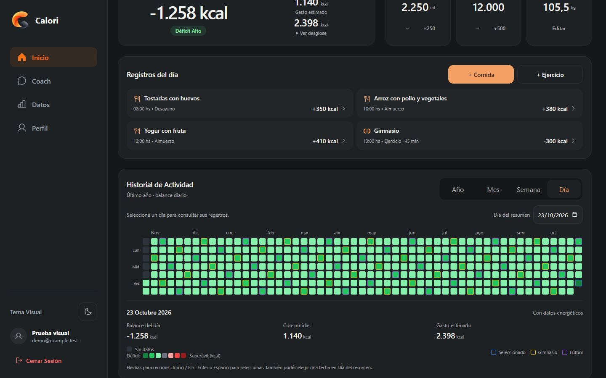
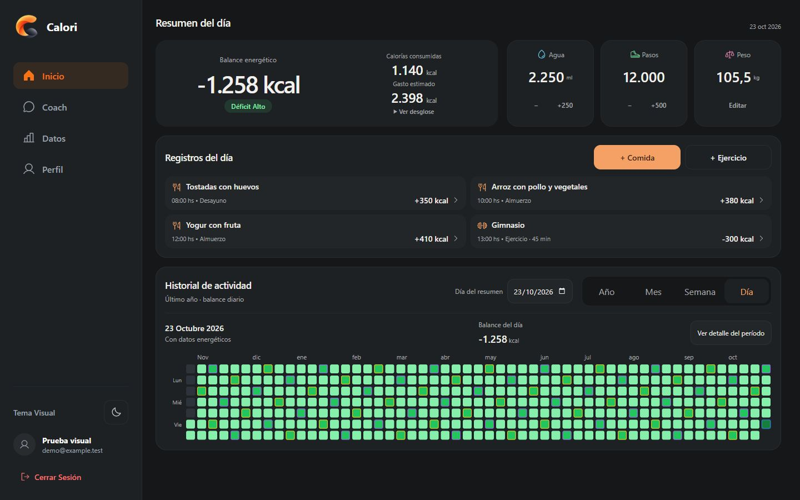
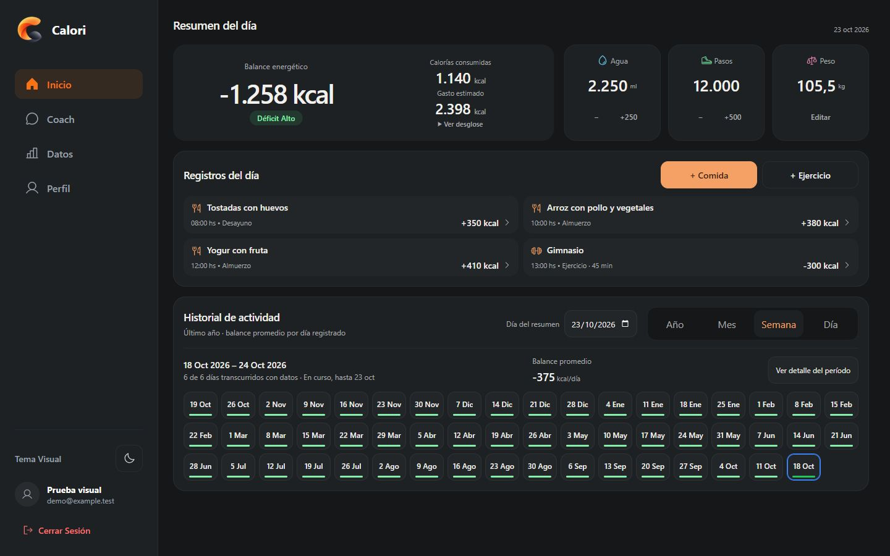
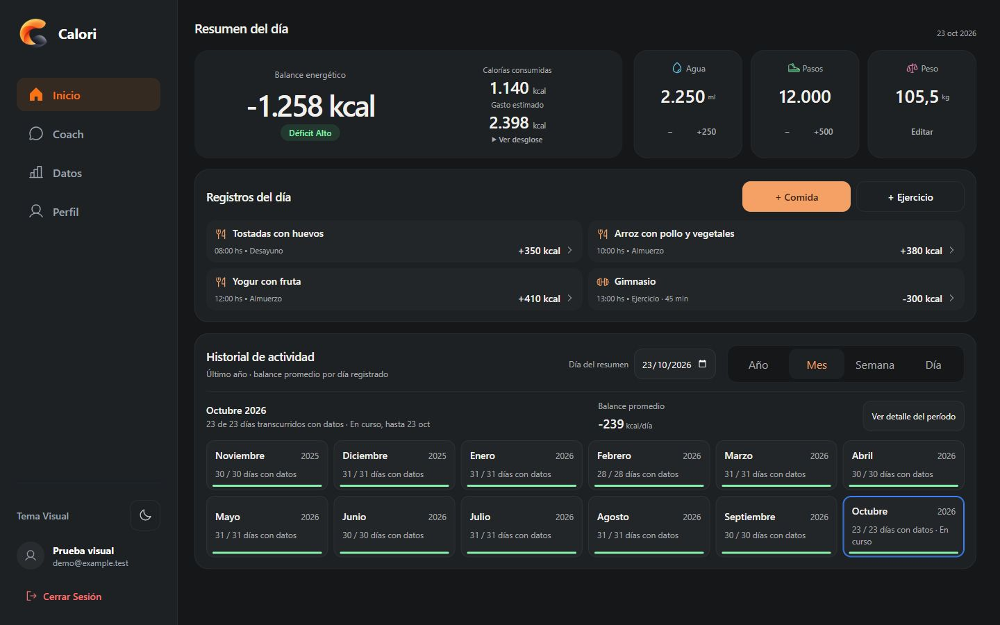
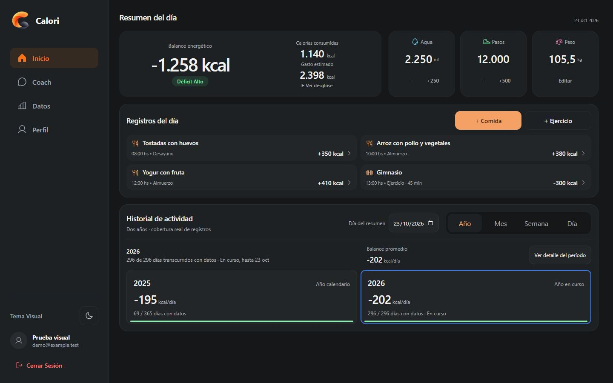
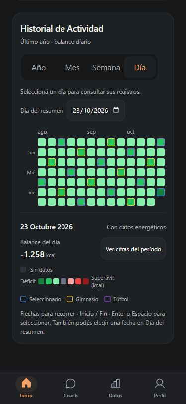
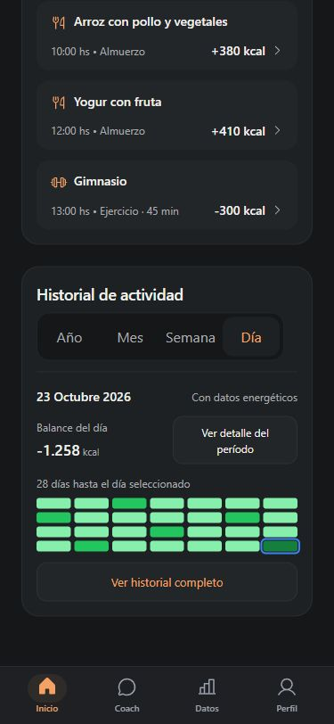
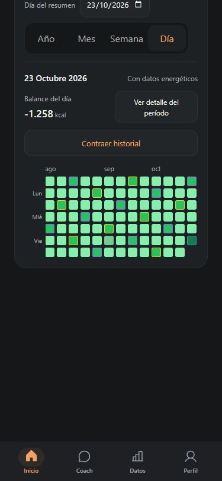

# Calori Premium V7 — Adaptive Home Experience

Base: main dc4f81e (PR #65 integrado). Rama: codex/adaptive-home-premium-v7.

- [PR #66 en borrador](https://github.com/MateoLitrenta/calori-tracker/pull/66).
- [Preview de la rama](https://calori-tracker-git-code-0fbec2-mateolitrenta-gmailcoms-projects.vercel.app). El estado del commit final y la comprobación pública se registran en el PR.

## Auditoría y alcance

Antes de editar se inspeccionó Inicio real, se guardaron capturas y se midieron las cuatro escalas en 1440×900 y móvil de 375 px. Las pruebas visuales utilizan los componentes reales con datos sintéticos y servicios locales simulados. El escenario de comparación tiene tres comidas y un entrenamiento, sin cambios entre antes y después. Las mediciones son del navegador, no de JSDOM.

La suma de filas y contenido secundario excedía el viewport de 900 px: Día +138 px, Semana +257, Mes +237 y Año +149. El encabezado diario ocupaba 32 px, la banda superior 164 y el journal con cuatro registros 244. El historial ocupaba 502/621/601/513 px según la escala. Su header de 54 px y el control de fecha de 44 estaban en filas distintas; el detalle de 96–122 px, las leyendas y las instrucciones ocupaban espacio permanente.

Solo se modifican DailyPanel.tsx, Heatmap.tsx y HomeVariants.css. Se conservan fórmulas, fechas del calendario, agregación, datos, registros, guardado, validaciones y servicios. DesktopExperience.css y los contenedores globales no necesitan cambios. Datos, Perfil y Coach no se modifican. No hay dependencias nuevas ni migraciones.

## Checkpoint A — desktop

Se mantienen las tres filas y el historial a ancho completo. La banda superior usa padding natural de 16 px; conserva métricas, controles de 44 px y la jerarquía del balance. Baja de 164 a 156 px con datos habituales y crece cuando el contenido lo requiere. La lista conserva dos columnas desde dos registros y cuatro visibles por defecto: su padding de fila pasa a 8×12 px, sin truncar texto o cifras. Con cuatro registros el journal baja de 244 a 220 px. Con uno o ninguno mantiene su alto natural; con ocho el botón permite mostrar todos y contraer, sin scroll interno.

El historial reúne título, fecha y selector en una toolbar. El resumen esencial presenta período, cobertura, balance y «Ver detalle del período». El detalle despliega cifras completas, método y leyendas dentro de la sección. Las instrucciones de teclado permanecen asociadas con aria-describedby incluso en el estado compacto. El orden DOM es toolbar, resumen, visualización: el contexto queda junto a los controles y coincide con la navegación por teclado.

Se conserva el calendario diario completo. Semana usa 18 columnas desde 1440 px (tres filas), 15 en notebooks; Mes usa seis columnas desktop; Año conserva sus dos bloques. Las celdas agrupadas siguen midiendo al menos 44 px. Las celdas del calendario diario mantienen la geometría existente y su alternativa táctil de fecha de 44 px.

Con cuatro registros, el historial compacto ocupa aproximadamente 330/315/339/298 px. Los gaps estructurales de Inicio pasan de 24 a 16 px; en pantallas de hasta 800 px de alto se usan 12 px. No se alteran tamaños de letra para forzar el resultado, no hay zoom CSS, scale, alturas recortadas ni listas con scroll interno.

### Resultado medido

A 1440×900, scrollHeight = clientHeight = 900 con cero, uno, tres y cuatro registros en las cuatro escalas. También caben ocho registros en su resumen de cuatro. Con ocho expandidos, el calendario diario requiere 104 px de desplazamiento natural. Con textos extensos y cifras de siete dígitos se requieren 45/29/54/13 px según Día/Semana/Mes/Año; el contenido permanece completo.

Con cuatro registros a 1920×1080 las cuatro escalas caben completas. A 1366×768 el exceso es 21/65/39/0 px; a 1280×720 es 57/113/87/46 px. Esos casos usan scroll natural para mantener lectura y targets, incluso después de aplicar la variante por altura. No se afirma que los notebooks entren completos.

Al expandir detalle, el contenido crece: el ejemplo semanal de cuatro registros pasa a 950 px de scrollHeight. No existe una franja fija reservada vacía.

## Checkpoint B — móvil

El orden principal permanece: balance, hábitos, acciones, registros e historial. La tarjeta de energía reduce padding redundante, sin reducir números. Se conservan navegación inferior, safe areas y bottom sheet.

El historial comienza con selector, período, balance, cobertura y una vista previa. Día representa hasta 28 días hasta la fecha consultada; Semana representa los 53 intervalos, Mes los 12 meses y Año los dos años originales. Las vistas previas usan los mismos helpers y colores; son informativas, sin celdas táctiles diminutas. Los valores completos y sus leyendas están en el detalle accesible.

«Ver historial completo» abre la visualización íntegra y el control de fecha; «Contraer historial» vuelve a la vista previa. «Ver detalle del período» controla exclusivamente cifras, método y leyendas. Los dos estados son independientes y tienen aria-expanded/aria-controls separados. Los intervalos y sus nodos no se desmontan al contraer. Al cambiar escala se conserva la selección de cada una; al redimensionar se revela solo el intervalo seleccionado, sin reset posterior del desplazamiento manual.

En 375 px, la presentación inicial se reduce aproximadamente de 666/701/811/630 a 384/424/416/408 px (los textos y períodos consultados pueden variar una línea). El historial completo conserva toda la información y puede requerir scroll vertical. No se confunde compactación con recorte de una grilla: la vista previa es explícita y la acción de expansión permanece visible.

Se probaron las cuatro escalas en 430×932, 375×812 y 320×740, compactas, completas, con cifras expandidas y de vuelta a compactas. La selección se conservó en las doce combinaciones. Ninguna tuvo overflow horizontal global. Los controles nuevos y los intervalos agrupados conservan targets de al menos 44 px.

## Checkpoint C — polish y regresiones

Se corrigió «Resumen del día» y se usa fecha localizada abreviada en el encabezado con time/dateTime; el detalle muestra la fecha completa y el selector conserva el formato nativo. Son representaciones adecuadas a su contexto, sin cambiar la fecha que recibe el guardado.

Cuando no hay comidas, la tarjeta usa «Balance provisional · Sin comidas registradas». Solo cambia la presentación, incluida la pastilla neutra. El número, TMB, gasto y registros permanecen iguales. Un día histórico realmente desconocido sigue mostrando Sin datos; no se incorpora nueva lógica energética ni se interpreta ausencia de comidas como un objetivo cumplido.

En tema claro se corrigió el contraste del nuevo botón usando el marrón del acento ya existente (#9a4d1f). El navegador confirmó rgb(154,77,31) sobre rgb(248,247,244); la prueba comprueba contraste AA del texto normal frente a una superficie blanca. No se agrega un color a la marca. Los estados de foco y las reglas de movimiento reducido se mantienen.

Se verificaron formularios con 18 líneas de descripción en los tres móviles: Guardar quedó dentro del viewport (bottom 728/800/920 con alturas 740/812/932). No se guardó ningún registro real. En desktop un borrador permaneció abierto al cambiar escala y desplegar el detalle. Ocho registros se expandieron y contrajeron manteniendo orden y contenido.

Datos, Perfil y Coach se revisaron también en navegador a 1440×900: mantienen ancho de 1126 px, sin overflow horizontal; Coach conserva scroll del transcript y el contenedor principal sigue acotado. La suite existente cubre sus interacciones y persistencia simulada.

## Validaciones

Suite completa final: 345/345 aprobados, cero fallos, cancelaciones u omitidos. Los 31 archivos se ejecutaron en tres lotes con node --test --test-concurrency=1: 135 + 127 + 83 pruebas. El manifiesto comprueba cobertura completa sin duplicados; cada lote terminó con código 0. Incluye PostgreSQL/RLS nativo y la prueba HTTP del artefacto serverless. Se aprobaron además 52 pruebas afectadas, TypeScript frontend y ambos proyectos API, lint (sin errores; 11 advertencias existentes), build (aviso existente de chunk mayor a 500 kB) y git diff --check.

Una suite previa de 344 pruebas pasó antes del último ajuste de contraste. Una repetición quedó sin resumen al perderse la sesión de ejecución; otra comprobación HTTP recibió connect EACCES 127.0.0.1 por permisos de red del sandbox. Esos intentos no se cuentan como aprobados. Tras restaurar el permiso se completaron los tres lotes, incluida la prueba HTTP, sin cambiar el endpoint, timeouts, cuotas ni reglas de seguridad. Los resultados y archivos cubiertos figuran en validation-summary.json y test-manifest.json.

Se añadieron regresiones para disclosures independientes, selección, nodos, borrador, foco, ARIA e instrucciones asociadas; presentación provisional que conserva números; CSS por ancho/alto, visualización completa en desktop y contraste del nuevo control. Los tests de estilos son contratos, no mediciones geométricas. La prueba de contraste inicial no pudo resolver una variable CSS en JSDOM: se ajustó para comprobar la declaración real y se contrastó su valor computado en navegador. No afectaba al producto. No se alteraron timeouts ni se omitieron pruebas.

## Capturas y datos

Todas las medidas están en [screenshots/adaptive-home-premium-v7](screenshots/adaptive-home-premium-v7), incluidos before-desktop, desktop-scenarios, desktop-sizes, mobile-matrix, light-matrix, forms y other-views.

Desktop 1440×900, cuatro registros:

Los otros estados iniciales: [Semana](screenshots/adaptive-home-premium-v7/before-Semana-1440.jpg), [Mes](screenshots/adaptive-home-premium-v7/before-Mes-1440.jpg), [Año](screenshots/adaptive-home-premium-v7/before-Año-1440.jpg).

Ocho registros [compactos](screenshots/adaptive-home-premium-v7/after-eight-Día-1440.jpg) y [expandidos](screenshots/adaptive-home-premium-v7/eight-expanded-1440.jpg). [Detalle completo](screenshots/adaptive-home-premium-v7/checkpoint-a-detail-1440.jpg). [Textos extensos y cifras grandes](screenshots/adaptive-home-premium-v7/after-large-Día-1440.jpg). [Balance provisional](screenshots/adaptive-home-premium-v7/after-empty-Día-1440.jpg).

Mobile 375 px:

[Inicio antes](screenshots/adaptive-home-premium-v7/before-mobile-home-375.jpg) y [después](screenshots/adaptive-home-premium-v7/after-mobile-home-375.jpg). La captura adicional de la banda superior anterior se reprodujo desde los tres archivos de origin/main en otro servidor local, con los mismos datos y fórmulas; no se cambió de rama ni se alteró el baseline.

Semana [compacta](screenshots/adaptive-home-premium-v7/final-mobile-compact-Semana-375.jpg) y [completa](screenshots/adaptive-home-premium-v7/final-mobile-full-Semana-375.jpg).
Mes [compacto](screenshots/adaptive-home-premium-v7/final-mobile-compact-Mes-375.jpg) y [completo](screenshots/adaptive-home-premium-v7/final-mobile-full-Mes-375.jpg).
Año [compacto](screenshots/adaptive-home-premium-v7/final-mobile-compact-Año-375.jpg) y [completo](screenshots/adaptive-home-premium-v7/final-mobile-full-Año-375.jpg).
[Detalle de cifras móvil](screenshots/adaptive-home-premium-v7/after-mobile-full-Mes-375.jpg), [tema claro](screenshots/adaptive-home-premium-v7/light-compact-Año-375.jpg) y [formulario abierto](screenshots/adaptive-home-premium-v7/form-open-320.jpg).

## Límites

Las capturas de pantallas autenticadas provienen del fixture local, no de una sesión real contra servicios remotos. Se valida el Preview público y su despliegue en el PR; queda pendiente revisión autenticada del usuario. La emulación de viewport no demuestra teclado virtual físico, Safari/iOS ni lector de pantalla real. El zoom nativo 125/150 % no está disponible en el navegador integrado; no se presenta CSS zoom como sustituto. La altura de contenido variable y el estado expandido pueden necesitar scroll, de forma intencional.

Sin merge ni modificaciones de Production, Supabase, variables remotas o IA. Pendiente de aprobación visual.
