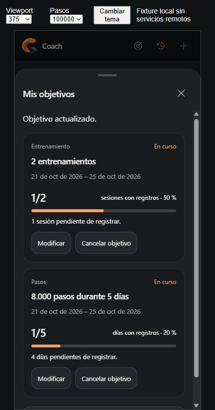
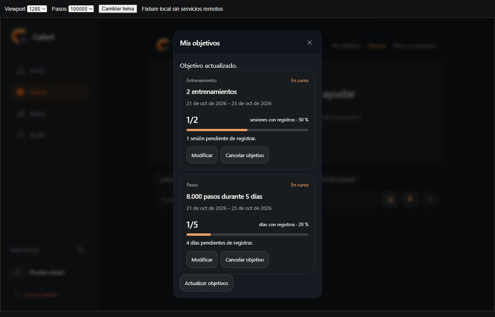

# Coach Goals Experience v1.2

## Auditoría previa a la implementación

Base: main `22a14af` (PR 56–59 integrados). El código existente soporta:

- `GET /api/coach/goals`: autentica al usuario, respeta `AI_COACH_GOALS_ENABLED`, devuelve hasta 12 objetivos y `hasMore`. Incluye todos los activos (máximo 8), aunque un período ya haya finalizado.
- `POST` con `accept`, `update` o `cancel`: solo después de confirmación. `update` permite `target` y `stepThreshold`; tipo y período se conservan. `cancel` cambia el estado a `cancelled`. No se admiten reactivación ni eliminación.
- `saveCoachGoal` compara `expectedVersion` al leer y al hacer PATCH. Cero filas es conflicto; no sobrescribe cambios de otro dispositivo. El trigger incrementa la versión. La aceptación con el mismo ID es idempotente.
- La migración existente fuerza RLS por `auth.uid() = user_id`, usa el JWT del propietario y restringe UPDATE a meta, umbral y estado. Identidad, tipo, fechas y versiones no se escriben directamente. No requiere ni se propone una migración nueva.
- `confirmCoachGoal` ya valida la propuesta y el resultado antes de mostrar éxito. `CoachGoalConfirmation` ya soporta las tres operaciones; la interfaz anterior solo exponía propuestas conversacionales.
- `evaluateCoachGoal` es el agregador compartido oficial. Entrenamiento cuenta sesiones; pasos cuenta fechas que alcanzan el umbral. Días sin entradas no confirman incumplimiento. Historial insuficiente devuelve `registered: null`.
- `AppStoreProvider` comparte un perfil y registros por propietario. `updateRecord` publica copias nuevas, reconcilia con Supabase y revierte ante fallos; las pantallas no deben mantener otra copia de actividades.

No hay incompatibilidad de esquema para modificar/cancelar. La solución mínima es exponer la lectura en el cliente, reutilizar la confirmación para escrituras y presentar progreso a partir del agregador actual. No se cambia la persistencia verificada ni se agrega otra fórmula de progreso.

## Límites existentes

La lista es acotada y anuncia `hasMore`; no promete todo el historial. El contexto oficial de actividad abarca 60 fechas. Los períodos sin cobertura completa se muestran sin progreso verificable, no como cero. Los estados «alcanzado» y «período finalizado» son interpretaciones de registros/período, no nuevos estados de la tabla.

Las metas modificadas en otros dispositivos se consultan al abrir el panel y recuperar foco/visibilidad, además de las lecturas al montar Coach. No se agrega polling ni una suscripción Realtime. Un error invalida la lista visible; un conflicto exige releer antes de volver a confirmar. Las actividades usan el estado compartido actual; los registros remotos de otros dispositivos se recuperan con los mecanismos existentes de carga de la app.

Referencias revisadas: [RLS](https://supabase.com/docs/guides/database/postgres/row-level-security), [permisos por columna](https://supabase.com/docs/guides/database/postgres/column-level-security) y changelog de Supabase (21/10/2026). No se inspeccionó ni modificó la base de Production.

## Implementación y origen de los datos

`useCoachGoals` comparte una lectura por propietario dentro de Coach, invalida solicitudes anteriores y borra la lista ante carga/error/flag desactivado. La lista vuelve a consultarse después de aceptar, modificar o cancelar. No usa almacenamiento local de objetivos ni crea actividad física.

`CoachGoalCard` consume `evaluateCoachGoal` sobre `buildCoachContext(activeProfile, today).historyDays`, los mismos registros compartidos de Inicio/Datos. El porcentaje es la relación visual entre el conteo oficial y la meta, acotada al 100 %; no reconstruye sesiones ni pasos. Las respuestas contextuales guardan solo un marcador de presentación en el historial, nunca una copia persistida de conteos. Al recuperar otra conversación se vuelven a evaluar los registros actuales y se indica la fecha.

`CoachGoalsPanel` reutiliza `EntryFormShell` y `CoachGoalConfirmation`. Revisar una modificación no escribe. Guardar usa `confirmCoachGoal`, la versión original y un bloqueo síncrono de doble clic. El diálogo de desktop tiene semántica modal, foco contenido, Escape y restauración de foco, sin marcar como `inert` a un ancestro del propio diálogo.

Las preguntas contextuales también reciben en la llamada existente a Gemini el contexto de objetivos calculado por el backend, mediante `readCoachGoals`, `readGoalActivity` y `evaluateCoachGoal`. Esto no cambia la selección de tarjetas nutricionales/de entrenamiento existente ni crea otra llamada al modelo. Las tarjetas se renderizan siempre desde datos estructurados locales oficiales.

## Archivos

- `src/components/ChatView.tsx`: acceso, panel y marcadores contextuales; conserva el compositor y el historial.
- `src/components/CoachGoalCard.tsx`, `CoachGoalsPanel.tsx`, `CoachGoals.css`: presentación y gestión de objetivos.
- `src/components/EntryFormShell.tsx`: accesibilidad modal de desktop reutilizable.
- `src/hooks/useCoachGoals.ts`: lectura, estados e invalidación por propietario.
- `src/services/coachGoals.ts`: lectura autenticada y errores tipados; conserva la escritura existente.
- `src/utils/coachGoalPresentation.ts`: etiquetas e intención de consulta compartida por cliente/backend.
- `api/ai/chat.ts`: incorpora evidencia de objetivos en consultas de progreso sin cambiar la presentación anterior.
- `tests/coach-store-sync.test.mjs`, `coach-goals-client.test.mjs`, `coach-goals.test.mjs`, `chat-view.test.mjs`: regresiones e integración.
- Este documento y las dos capturas de `docs/screenshots/coach-goals-*.jpg`.

## Validación

- Suite completa: **308/308**, cero fallos/omisiones (`node --test --test-concurrency=2 tests/*.test.mjs`). Incluye PostgreSQL nativo local para conflictos concurrentes/RLS/permisos y el probe HTTP del endpoint compilado sin fuentes TypeScript.
- TypeScript cliente/build y ambas APIs, lint y `git diff --check`: correctos. Lint mantiene 13 advertencias existentes y build conserva la advertencia de chunks grandes.
- Las pruebas de React ejecutan el entry point, el store, la navegación, los formularios y los componentes reales, con Auth/DB/IA simulados. Verifican modificación/cancelación explícitas, doble clic, error/conflicto, invalidación por usuario/flag, persistencia entre conversaciones/recarga y agregar/editar/eliminar entrenamientos y actualizar pasos desde Inicio.
- Las pruebas de contrato/API usan el SQL existente en PostgreSQL/PGlite local con JWT sintético y proveedor simulado. Confirman datos oficiales para las tres consultas contextuales, sin escrituras por renderizado ni llamadas extra a Gemini. No prueban servicios remotos.

### Navegador local, datos simulados

Revisado en el navegador integrado con la app real y adaptadores locales de Auth/DB/IA/objetivos, sin llamadas externas. Se inspeccionaron 320, 375, 430, 768 y 1280 px: cabecera, tarjetas, bottom sheet y diálogo desktop. Se recorrió la modificación de 3 a 2 sesiones mediante revisión y confirmación explícita; la tarjeta pasó de 1/3 (33 %) a 1/2 (50 %). Consola: sin errores ni advertencias.

No son capturas de Production ni prueban Supabase remoto. Queda pendiente validar en Preview con una cuenta real y teclado virtual de iOS/Android. No se ejecutaron migraciones, escrituras remotas ni cambios de variables.
