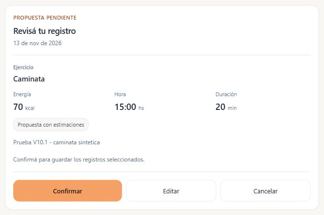
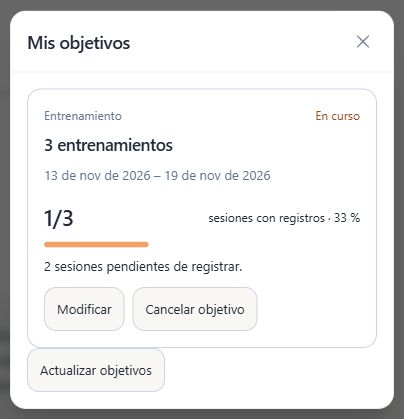
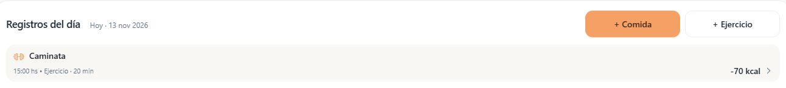
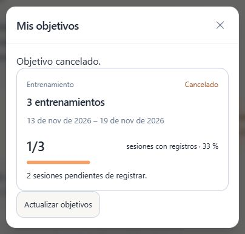
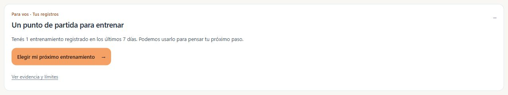

# V10.1 — Resultado de validación posterior al despliegue

Fecha: 13 de noviembre de 2026. Estado: **validación real parcial, con dos fallos conversacionales recuperables**. Gemini real respondió en Production; no se declara una certificación general de la IA ni se aprueba todavía la corrección local para Production.

## Versión y límites de la sesión

- `main` sincronizado en `44c79e85654408557037be4304a27aa2f26c5fbf`, merge de PR #77.
- Vercel confirmó ese SHA, rama `main`, entorno Production y estado READY. URL pública: <https://calori-tracker-tan.vercel.app>.
- Protocolo: [comprobación posterior al despliegue](coach-intelligence-v10-1-post-deploy.md).
- Se utilizó exclusivamente la cuenta de prueba identificada y autorizada por el usuario, con inicio de sesión realizado por él. Su identidad no forma parte de este informe, fixtures o capturas.
- Los cambios se hicieron por los controles normales del producto: un objetivo sintético aceptado, modificado y finalmente cancelado; una caminata sintética de 20 minutos el 13/11/2026 a las 15:00, conservada como registro identificable. No se borró la conversación ni se eliminaron registros.
- Supabase se consultó únicamente mediante SELECT acotados a esa cuenta y conteos necesarios. No se ejecutaron escrituras SQL, migraciones, cambios de RLS, secretos, configuración, cupos, merges ni despliegues.

## Pruebas automatizadas

**Aprobadas en el main desplegado: 241/241 pruebas, 23 archivos, cero fallos, cancelaciones, omisiones o TODO.** Node 24.4.1; ejecución serial de 190,5 segundos en Windows. Gemini, Auth, cuotas y límites remotos se simulan; PGlite y HTTP de loopback se ejecutan realmente. Esto verifica contratos y comportamiento de código, no la calidad de Gemini real.

La muestra comprende proactividad, contexto, hábitos, transporte, React→HTTP→handler, objetivos/propuestas, almacenamiento por cuenta, confirmación, persistencia de registros y cuotas. Cubre que abrir Coach/expandir evidencia no llama al proveedor; referencia seleccionada enviada al backend; evidencia recalculada ante agregados obsoletos/manipulados; progreso oficial; cambio de cuenta; fallos de transporte sin reintentos o guardados silenciosos. Se observaron dos avisos `act(...)` del harness existente.

**Regresión Linux heredada: 654/654 en 52 archivos, cero omisiones**, ejecutada antes del merge sobre `f628fe450807473150211b812a326a7db50ac9f5`. Los directorios de aplicación, servidor, API, tests, scripts, dependencias y CI son idénticos a los de `44c79e8`; el árbol completo de main coincide con el último commit del PR #77. No se presenta como una nueva ejecución Linux sobre main ni como resultado del fix posterior. [Ejecución](https://github.com/MateoLitrenta/calori-tracker/actions/runs/43477100255), [evidencia conservada](evidence/v10-1/linux-ci-final.json).

**Candidata local corregida: 254/254 pruebas en los mismos 23 archivos, cero fallos, cancelaciones, omisiones o TODO.** Esta ejecución incluye las nuevas pruebas de fechas naturales, cancelación segura e interfaz de sugerencias. La revisión estática independiente del diff no encontró problemas accionables; no equivale a una prueba real de Gemini para ese código.

TypeScript del frontend, API de IA y objetivos, lint, build y diff-check terminaron con exit 0. Persisten 12 advertencias anteriores de lint, dos avisos `act(...)` del harness y el aviso anterior de tamaño de bundle. Las fuentes no cambiaron durante la ejecución: huella agregada SHA256 `684a36aa4df9e206dd39230537570c017b2bb12215c24f6280d3c37949b0f40d`. [Resultado final local](evidence/v10-1/post-deploy-2026-11-13/candidate-automated-result.json).

El job Linux aplicable es `staging-schema-v9-1.yml`; el antiguo job de integración restringido a PR #71 no se cuenta como validación de esta rama. El resultado Linux de la candidata debe consultarse en los checks y la descripción del PR Draft, asociados a su SHA, junto con el artifact `staging-schema-rehearsal`; no se infiere del resultado anterior de 654 pruebas. El equipo local dispone de Windows y sólo la distribución interna de Docker Desktop; no hay una distribución Linux de desarrollo disponible ni daemon Docker en ejecución. No se presenta la muestra local de 23 archivos como la suite Linux completa.

[Baseline automatizado](evidence/v10-1/post-deploy-2026-11-13/main-automated-result.json) y [manifiesto de archivos](evidence/v10-1/post-deploy-2026-11-13/automated-manifest.json).

## Verificaciones técnicas remotas

**Aprobadas:** GET `/`, `/app` y `/login` devolvieron 200. GET `/api/ai/chat` devolvió 405; POST sin credenciales devolvió 401; GET `/api/coach/goals` sin credenciales devolvió 401. Las comprobaciones se hicieron sin extraer tokens o cookies del navegador. La telemetría de los errores de chat indicó `providerCalls: 0`.

El acceso autenticado, las propuestas, los objetivos guardados y el registro único funcionaron por la interfaz de Production. No se detectó un fallo evidente de configuración de Gemini/Coach en estos recorridos. La consulta acotada de logs con nivel error/fatal no devolvió filas durante la ventana controlada; los eventos `ai_request` también se revisaron por contenido porque se emiten como info, incluso ante errores. No equivale a ausencia global de errores. La consola del navegador mostró dos errores de una extensión MetaMask, ajena a Calori; no se alteró la extensión.

## Gemini real: resultados por recorrido

1. **APROBADO — Apertura y evidencia.** La observación inicial reconoció ausencia de comidas, entrenamientos y pasos registrados en los últimos siete días. Abrir Coach, consultar sus sugerencias y expandir evidencia no creó reservas de cuota. La conclusión se limita a ese período, no a todo el historial de la cuenta.
2. **APROBADO — Conversación contextual.** La acción inicial recomendó empezar por un registro sencillo. La explicación posterior reconoció que faltaban registros y no afirmó fútbol, gimnasio, inactividad física o consumo cero. No convirtió la falta de entradas en incumplimiento.
3. **FALLIDO — Alta con fechas naturales.** Una petición completa de dos entrenamientos en total, del 13 al 19 de noviembre de 2026, recibió una aclaración genérica que solicitaba nuevamente meta y fechas. No apareció propuesta ni se guardó nada. La misma petición con fechas ISO produjo la propuesta correcta. Reproducido localmente: la gramática determinística no admitía `en total` y ese rango natural; el guard de propuestas del modelo tampoco lo reconocía.
4. **APROBADO — Alta confirmada mediante ISO.** La propuesta mostró dos sesiones, fechas exactas, alcance de todos los entrenamientos y aviso de que sólo se guarda al confirmar. Antes de confirmar no existía objetivo activo; después existió uno, versión 1. Aceptarlo no creó actividad ni consumió otra llamada de IA.
5. **APROBADO — Registro confirmable único.** Se mostró una caminata de 20 minutos, fecha/hora explícitas, nombre sintético en los detalles y 70 kcal identificadas como estimación. Antes de confirmar había cero entrenamientos de prueba guardados; después hubo exactamente uno. Inicio lo conservó tras recargar. No se confirmó dos veces ni se provocó concurrencia real: la idempotencia concurrente se cubre en las pruebas automatizadas.
6. **APROBADO — Evidencia y sugerencias cambiantes.** La caminata cambió el progreso a 1/2 y las sugerencias incorporaron el entrenamiento registrado. La acción contextual pasó a «Ver avance de entrenamientos». La siguiente respuesta real utilizó 1 de 2 y respetó el período; no utilizó la ausencia inicial como evidencia vigente. Se detectó además concordancia singular incorrecta en una sugerencia, corregida localmente junto con el caso equivalente de pasos.
7. **APROBADO — Modificación.** Gemini propuso cambiar la meta a tres sesiones manteniendo fechas. La base conservó target 2/version 1 hasta confirmar; después mostró target 3/version 2 y progreso 1/3. La recarga y «Mis objetivos» recuperaron esos valores sin IA adicional.
8. **FALLIDO — Cancelación conversacional.** La petición explícita de cancelar el único objetivo de entrenamiento confirmado recibió la misma aclaración genérica. El objetivo permaneció activo; no hubo modificación silenciosa. Reproducción local: un objeto cancel válido con ID oficial funciona; una propuesta omitida o con ID no válido reproduce el fallo. La telemetría disponible no permite distinguir cuál devolvió el modelo en esta solicitud. Falta una recuperación determinística segura para esa orden inequívoca.
9. **APROBADO — Descartar y cancelar por interfaz.** «Cancelar objetivo» abrió una confirmación. Descartarla conservó target 3/version 2, un entrenamiento y cuota 8. Reabrirla y confirmar dejó el objetivo cancelado/version 3. Ninguna de esas operaciones invocó Gemini; la observación volvió a centrarse en el entrenamiento registrado.

Los dos fallos de objetivos devolvieron HTTP 200 y `category: success`: el transporte terminó correctamente, pero la operación conversacional no. No se usa el estado HTTP como aprobación funcional.

## Latencia, llamadas y coste

- Ocho envíos manuales; ocho eventos reales con una llamada al proveedor cada uno; cero intentos correctivos adicionales observados.
- Cuota de texto: 0→8; límite diario sin modificar: 30. Apertura, evidencia, aceptación, confirmación de registro, modificación, descarte, cancelación y navegación no agregaron reservas por sí mismos.
- Duración del endpoint: mínimo 1.523 ms, mediana 1.884 ms, máximo 2.067 ms; ocho muestras. Incluye validación, autenticación, cuota, lectura de objetivos y proveedor. No mide sólo Gemini ni el tiempo completo de interacción del navegador; no es un benchmark o SLO.
- Tokens informados: 71.346 de entrada + 904 de salida = 72.250; `tokenCoverage: complete` en las ocho muestras. La cobertura describe metadatos, no calidad o facturación.
- Abrir Coach y recalcular determinísticamente aportan cero llamadas adicionales. Cada conversación explícita conserva el coste del envío existente. Los dos fallos recuperables también consumieron una unidad: no se asume devolución.
- No se inspeccionaron secretos, el modelo configurado en Production ni la factura del proveedor. No se atribuye un importe monetario a estos tokens. Como presupuesto sin caché u otros ajustes: `0,071346 × tarifa de entrada por millón + 0,000904 × tarifa de salida por millón`, usando las tarifas efectivamente aplicables al proyecto. La entrada domina la muestra; V10.2 debe mantener contexto acotado y evitar generar un plan por cada apertura o por cada área.

[Telemetría sin identidad ni contenido](evidence/v10-1/post-deploy-2026-11-13/telemetry.json).

## Capturas de la cuenta de prueba, sin identidad

Los recortes excluyen avatar, nombre, correo y mensajes privados. Sólo contienen el recorrido sintético.

## Pendientes y límite de aprobación

- **Correcciones locales con Gemini real:** sólo podrán validarse después de un merge/despliegue expresamente autorizado. Production continúa en `44c79e8`, con ambos fallos reproducibles. Repetir alta natural y cancelación inequívoca; mantener confirmación, fechas, versiones, cuota y ausencia de actividades implícitas.
- **400 autenticado real:** cubierto en simulación; no ejecutado remotamente porque no hay un control normal de UI para enviar el payload inválido y no se extrajeron credenciales del navegador. El 401 remoto sí se comprobó.
- **429, timeout y caída real del proveedor:** comportamiento automatizado cubierto; no se agotaron cupos ni se alteró configuración para provocarlos. No ocurrieron naturalmente en la muestra.
- **Aislamiento remoto con dos cuentas:** cubierto por pruebas sintéticas; falta una segunda cuenta expresamente autorizada y una sesión controlada para probarlo en Production.
- **Lectura desde otra conversación independiente:** persistencia verificada tras recarga y panel «Mis objetivos»; no se borró la conversación local para abrir una nueva. Esa variante sigue pendiente.
- **Otros contextos reales:** se ejercitó ausencia de registros recientes y luego una caminata con objetivo. Fútbol más gimnasio, regularidad alimentaria variable y datos ricos/inconsistentes conservan evidencia sintética de V10.1; no se presentan como conversaciones reales ejecutadas hoy.
- **Móvil y temas de esta sesión remota:** las capturas actuales son desktop/tema claro. La evidencia responsive y claro/oscuro de PR #77 se conserva como prueba anterior, no como nueva ejecución remota. Las correcciones de esta rama no cambian CSS ni layout.

El resultado permite afirmar que la integración real responde, personaliza y respeta confirmaciones/cuotas en los casos aprobados. Los dos fallos y los casos pendientes impiden declarar todos los recorridos certificados. La siguiente evolución propuesta, aún sin autorización de implementación, está en [V10.2 — Planificación inteligente](coach-intelligence-v10-2-proposal.md).

## Corrección y publicación del Draft

Rama local: `codex/coach-goal-natural-date-range-fix`, desde `44c79e8`. Corrige el rango natural inequívoco y `en total` sin confiar en fechas/metas del modelo; conserva validación de calendario, ventana y duración, y pide aclaración para rangos ambiguos. Para la orden actual explícita de cancelación, reconstruye una propuesta con ID/versión oficiales sólo si la lista está completa y hay un único objetivo activo total, de entrenamiento. La selección ambigua, lectura fallida o lista truncada no genera propuesta. Los botones, endpoints y reglas de confirmación/persistencia existentes permanecen como mecanismo de guardado. También corrige la concordancia de sugerencias para una sesión o un día con pasos.

La corrección **no está en Production**. No cambia tablas, RLS, cupos, variables ni configuración desplegada.

Publicar una rama del repositorio conectado puede crear una Preview automáticamente, incluso con un PR Draft. No hay un marcador de commit documentado que se use como garantía de exclusión. El mecanismo oficial `git.deploymentEnabled` permite excluir una rama exacta mediante `vercel.json`; requiere modificar ese archivo. [Vercel for GitHub](https://vercel.com/docs/git/vercel-for-github), [configuración por rama](https://vercel.com/docs/project-configuration/git-configuration#gitdeploymentenabled).

El usuario autorizó expresamente aplicar esa exclusión exacta y publicar el Draft. `vercel.json` excluye únicamente `codex/coach-goal-natural-date-range-fix`, sin comodines; los cuatro rewrites se conservan. `main` y las demás ramas mantienen su comportamiento por defecto. La regla se verifica estáticamente y la ausencia de nuevos despliegues se comprueba por separado en Vercel tras el push. No se autoriza merge ni cambios en Production.

La exclusión es temporal y debe retirarse antes del merge siguiendo el [procedimiento de retiro](coach-intelligence-v10-1-draft-deployment-exclusion.md). Retirarla y subir el commit puede reactivar la Preview: esa transición requiere autorización previa, no se ejecuta dentro de este Draft. La implementación de V10.2 permanece pendiente de aprobación independiente.
