# Calori Premium V8.1 — Daily Heatmap Refinement

Continuación del [PR #67 en borrador](https://github.com/MateoLitrenta/calori-tracker/pull/67), sobre la misma rama `codex/frictionless-history-ux-v8`. Se corrige exclusivamente la presentación y navegación de Día. Semana, Mes y Año conservan la dirección funcional aprobada de V8.

Se publica un commit específico de V8.1 en la misma rama y el mismo [PR #67](https://github.com/MateoLitrenta/calori-tracker/pull/67). [Preview de la rama](https://calori-tracker-git-code-87e5e2-mateolitrenta-gmailcoms-projects.vercel.app). El SHA publicado y la comprobación Ready del despliegue final quedan registrados en la descripción y los checks del PR. El Preview público no demuestra una sesión autenticada.

No se hizo merge ni se modificó Production. No se ejecutaron migraciones ni cambios en servicios remotos.

## Causa y solución

V8 tenía dos visualizaciones diarias: una cinta de tarjetas de fecha de 52×77,99 px y un calendario anual expandible cuyas celdas móviles medían 44×44 px. Ambas resolvían la selección de fechas con presentaciones diferentes. Aunque permitían selección directa, esas dimensiones sustituyeron la geometría característica del heatmap y añadieron un acceso redundante.

V8.1 utiliza un único calendario anual compartido entre móvil y escritorio. Siempre está disponible, conserva siete filas por semana y permite seleccionar directamente cualquier fecha visible. Se eliminan las tarjetas verticales, el segundo conjunto de botones diarios, `dayStripRef`, `historyExpanded` y «Explorar calendario anual». No se necesita abrir un panel para utilizarlo.

Las fechas proceden de `buildHistoryPeriods`; no se construye un calendario paralelo. En la fecha fija de la prueba, 26 de octubre de 2026, se midieron 53 columnas y 366 fechas seleccionables. Cada columna conserva siete posiciones; las posiciones posteriores a hoy son espacios vacíos, no botones ni fechas futuras activables.

El selector de escala, el resumen contextual, la fecha exacta, las métricas principales y la explicación secundaria siguen disponibles. En el calendario compacto hay controles explícitos para explorar fechas anteriores o siguientes, además del desplazamiento horizontal interno.

## Tamaño visual, superficie de interacción y compromiso

Hasta 1023 px de ancho, cada fecha tiene un botón exterior de 24×24 px y un cuadrado coloreado interior de 16×16 px. La separación entre botones es de 4 px: el paso entre columnas y filas es de 28 px, y la distancia visual entre cuadrados contiguos es de 12 px. El radio computado de los cuadrados es de 3 px y utiliza el token existente.

El cuadrado interior es decorativo, con `aria-hidden` y sin capturar eventos de puntero. El botón exterior concentra nombre accesible, fecha, selección y foco. Un toque dentro de su superficie de 24 px selecciona la fecha, aunque caiga fuera del cuadrado coloreado. No hay hitboxes superpuestas; esa ausencia de intersecciones se midió en los nueve tamaños del tema oscuro.

Los colores y bordes siguen usando `getHeatmapColor`, `getHeatmapActivities` y `getHeatmapBorder`. Se conservan déficit verde, superávit rojo, gris sin datos y los bordes de gimnasio, fútbol y selección, con su prioridad existente. La selección no reemplaza el valor energético del color interior.

24 px es un compromiso de densidad y precisión y resulta menor que una superficie de 44 px. No se presenta como una certificación de accesibilidad táctil completa. El selector nativo de fecha mantiene 44 px de alto en los nueve tamaños medidos, y las flechas de navegación conservan superficies de al menos 44×44 px en la presentación compacta. Esa alternativa permite elegir una fecha exacta sin depender de acertar sobre un cuadrado pequeño.

Escritorio conserva la geometría aprobada: el cuadrado interior ocupa el botón existente. Las medidas de lado fueron aproximadamente 21,84 px a 1920, 15,92 a 1440, 14,52 a 1366 y 12,90 a 1280. A 1024 px se mantienen 16 px y scroll horizontal dentro del calendario. No se agrandó el calendario de escritorio para uniformarlo con el target compacto de móvil.

## Geometría, etiquetas y navegación

Una misma dimensión de celda interactiva controla el paso de las columnas, las filas de días y los offsets de las etiquetas de mes. El cuadrado interior utiliza una dimensión separada. Así se evita que las etiquetas queden desfasadas al usar 24 px de interacción y 16 px de color.

Los nombres de días quedan fuera del scrollport y mantienen su alineación con las siete filas. Las etiquetas de mes se desplazan junto con el contenido del calendario. El calendario puede desplazarse horizontalmente dentro de su contenedor, sin ampliar la página.

El foco recorre fechas válidas por su posición real: arriba y abajo se mantienen dentro de la semana; izquierda y derecha conservan el día de la semana en columnas adyacentes. En los extremos se detiene, sin saltar a un día distinto ni enfocar una posición futura. Inicio y Fin llevan a la primera y última fecha válida. Las flechas mueven el foco; Enter y Espacio activan el botón nativo y realizan la selección.

## Estado, datos y alcance

El día consultado sigue siendo `selectedDateStr`, actualizado por el flujo existente `onSelectDate`. Seleccionar una celda actualiza inmediatamente el resumen contextual y el día de Inicio. Las selecciones de Semana, Mes y Año siguen siendo independientes y no cambian el día consultado.

La exploración recuerda el desplazamiento por escala y presentación compacta/amplia. Un clic sobre una celda no recentra el calendario; un salto explícito con el selector de fecha revela la selección una vez. Al volver a una escala o redimensionar se conserva la posición correspondiente. Los clics permanecen aislados dentro de la sección para no disparar el cierre exterior del formulario de DailyPanel ni borrar sus borradores.

No se modifican `aggregateEnergy`, `getNetBalance`, TMB, gasto, clasificación energética ni los registros. Balance, consumidas, gasto, cobertura parcial, ausencia de datos y balance provisional conservan los resultados y reglas existentes. Navegar no genera guardados. Semana, Mes y Año mantienen sus controles, estructura, rangos y cálculos de V8; el ajuste de teclado diario queda acotado al calendario de siete filas.

Archivos de implementación: `src/components/Heatmap.tsx` y `src/components/HomeVariants.css`. Se actualizan regresiones en `tests/history-experience.test.mjs`, `tests/precision-layout.test.mjs` y `tests/ui-polish.test.mjs`, además de este documento y su evidencia. No hay cambios en persistencia, Supabase, autenticación, Gemini, cuotas, objetivos, endpoints, migraciones ni dependencias. No se rediseñan Inicio completo, Datos, Perfil o Coach.

## Comparación visual reproducible

Las versiones históricas se reprodujeron desde commits fijos con los mismos componentes reales y cuatro registros sintéticos normales: V7 en `a6cd5df` y V8 en `881c86d`. Esas capturas históricas se generaron después de editar V8.1; no se presentan como capturas tomadas previamente. Se conserva además la captura desktop V8 realizada antes de modificar el código (`before-v8-day-1440.jpg`). Las capturas previas de V8 ya publicadas permanecen en su carpeta original.

A 375 px, las [mediciones de referencia](screenshots/daily-heatmap-refinement-v8-1/baseline-measurements.json) muestran:

- V7, calendario anual abierto: lado visual de 16 px y sección de historial de 529 px.
- V8, cinta de tarjetas: 52×77,99 px por tarjeta y sección de 626,18 px.
- V8, calendario anual abierto: celdas de 44 px y sección de 846,19 px.
- V8.1, calendario único: botón de 24 px, cuadrado visual de 16 px y sección de 706,19 px.

V8.1 reduce aproximadamente 140 px frente al calendario anual abierto de V8. Ocupa aproximadamente 80 px más que la cinta inicial de V8 y 177 px más que el calendario abierto de V7. No se afirma que sea más corto que todos los estados anteriores: las siete filas de targets reales de 24 px y las métricas principales siempre visibles tienen un costo de altura. La mejora recupera la identidad de cuadrados pequeños y elimina la doble navegación sin volver a una vista pasiva.

## Verificación en navegador

La [matriz responsive](screenshots/daily-heatmap-refinement-v8-1/responsive-matrix.json) registra 72 casos: cuatro escalas, temas claro y oscuro y nueve resoluciones: 1920×1080, 1440×900, 1366×768, 1280×720, 1024×768, 768×1024, 430×932, 375×812 y 320×740. Ningún caso presenta overflow horizontal global. Las mediciones son de navegador; JSDOM no se usa para demostrar geometría.

Con cuatro registros normales, a 1440×900 las cuatro escalas conservan `scrollHeight = clientHeight = 900` en ambos temas. Se mantiene el resultado desktop documentado para V8. Los viewports más bajos pueden necesitar scroll vertical natural; no se recorta contenido para hacerlos caber.

En 768, 430, 375 y 320 px se comprobaron superficies de 24×24 px y cuadrados interiores de 16×16 px, con scroll horizontal local. La altura de la sección Día fue 722,19 px a 768, 706,19 a 430 y 375, y 724,19 a 320. Son alturas del historial, no de Inicio completo. El aumento a 320 corresponde al flujo natural de textos y controles; no se usa una altura fija para ocultarlos.

Las [interacciones registradas](screenshots/daily-heatmap-refinement-v8-1/interactions.json) incluyen un clic nativo de puntero en un punto exterior al cuadrado coloreado pero interior al botón. El botón ocupaba x=298…322 y su cuadrado x=302…318; pulsar x=299 seleccionó el 25 de octubre de 2026. El resumen mostró de inmediato −138 kcal de balance, 1.800 kcal consumidas y 1.938 kcal de gasto estimado, y la fecha de Inicio quedó sincronizada.

También se activaron fechas mediante Enter y Espacio, se probaron Inicio y Fin y se verificaron los límites de fila: Arriba desde domingo no cruza de semana y Abajo contra una posición futura no mueve el foco a una celda inexistente. El selector nativo de fecha se operó con teclado y actualizó la fecha y el resumen al 25 de octubre.

La comprobación de foco separó enfoque y selección: Flecha Izquierda llevó el foco del 26 al 19 de octubre sin cambiar la fecha seleccionada. El navegador registró un contorno naranja de 2 px. Otro fixture con datos variados conservó las ocho categorías semánticas existentes (sin datos y siete rangos energéticos) y los bordes de gimnasio, fútbol y selección; al seleccionar el 30 de marzo mostró −650 kcal, 1.588 kcal consumidas y 2.238 kcal de gasto, usando los helpers oficiales.

Estas comprobaciones usan los componentes verdaderos con autenticación, datos e IA simulados localmente. Son interacciones reales de navegador con fixtures; no equivalen a precisión de dedo en un teléfono ni a una sesión autenticada en el Preview remoto. No se enviaron datos personales ni registros a servicios remotos.

## Pruebas y validaciones

Suite completa: **353/353 aprobadas**, cero fallos, cancelaciones u omitidos. Los 31 archivos se cubren una vez en tres lotes disjuntos de `node --test --test-concurrency=1`: 136 + 127 + 90. Cada lote terminó con código 0. El [manifiesto](screenshots/daily-heatmap-refinement-v8-1/test-manifest.json) detalla los archivos ejecutados. Incluye las pruebas existentes de PostgreSQL/RLS en un entorno local descartable y la prueba HTTP del artefacto serverless; no se aplica ninguna migración remota.

Las 25 pruebas relacionadas también aprobaron. Las regresiones verifican selección directa, resumen oficial actualizado, día consultado, borradores, una sola visualización diaria, siete posiciones por semana, botones y cuadrados semánticos, fechas futuras no interactivas, navegación de teclado, límites de fila, fecha accesible, restauración de scroll por modo, saltos explícitos y conservación de Semana/Mes/Año. Los contratos CSS comprueban geometría compacta, calendario visible, foco y movimiento reducido; las medidas reales se verifican por separado en navegador.

TypeScript frontend y los proyectos API de IA y Coach terminaron sin errores. Lint terminó con código 0 y conserva 11 advertencias previas. Build terminó con código 0 y conserva el aviso existente del chunk superior a 500 kB. No se debilitan pruebas ni se omiten validaciones para obtener estos resultados.

git diff --check aprobado. [Resultados completos y límites de validación](screenshots/daily-heatmap-refinement-v8-1/validation-summary.json).

## Capturas

Referencias históricas, con las condiciones reproducidas indicadas arriba:

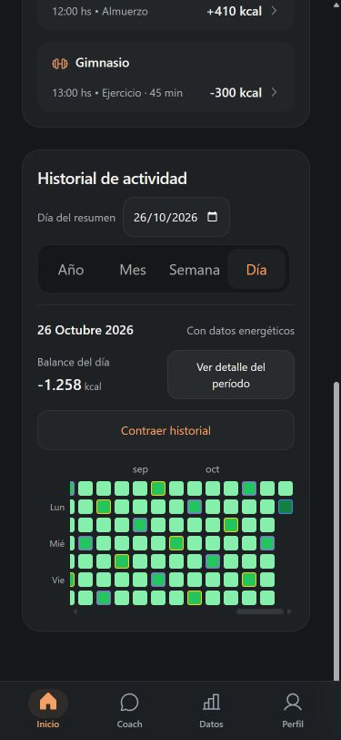

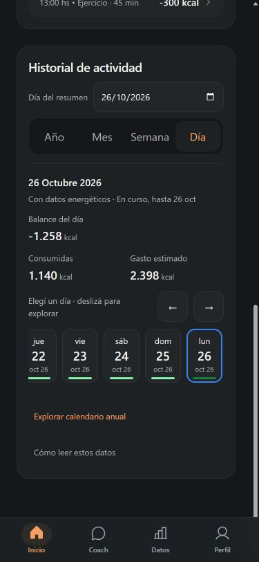

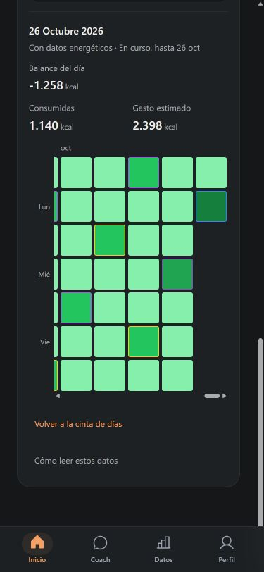

Calendario único V8.1:

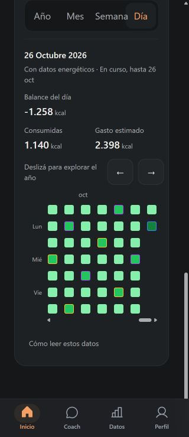

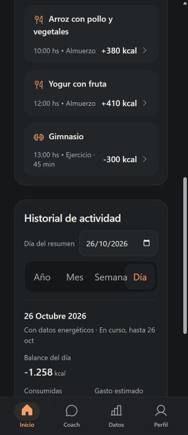

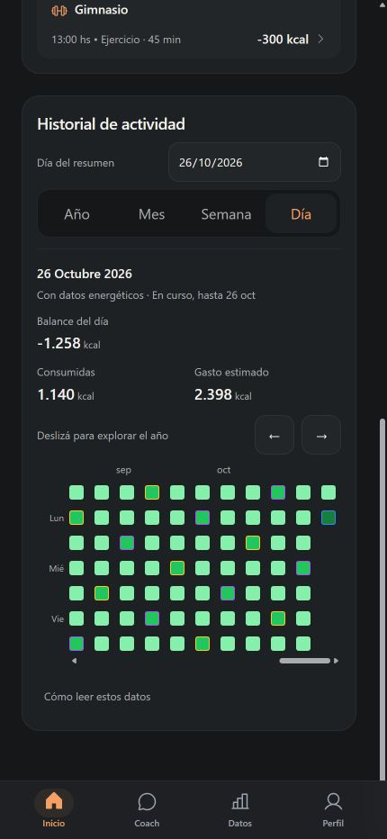

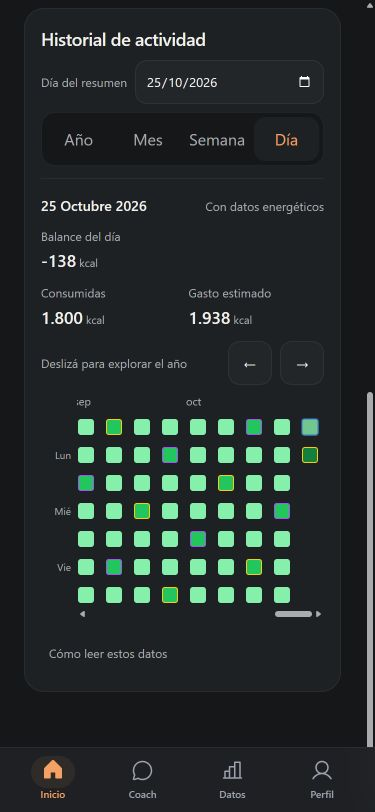

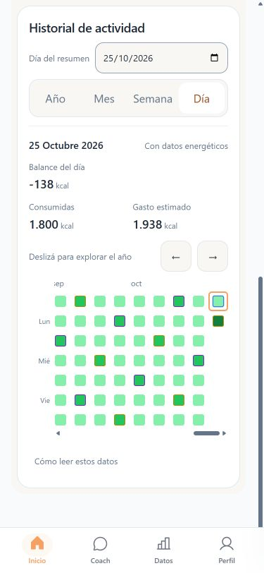

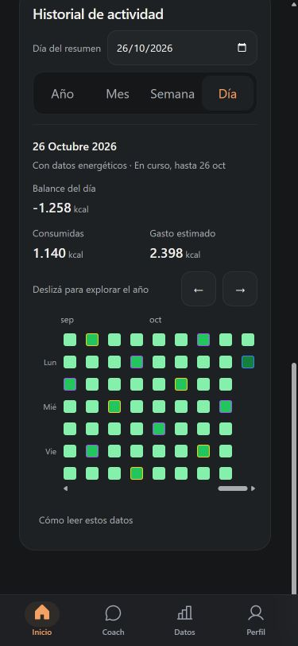

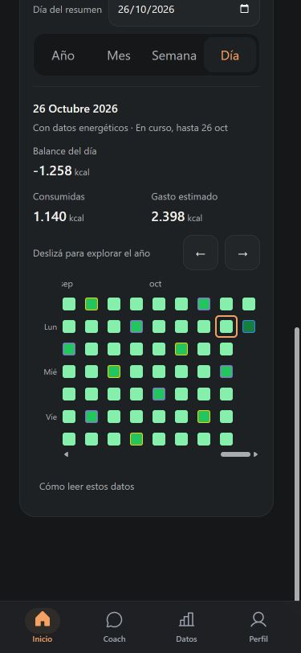

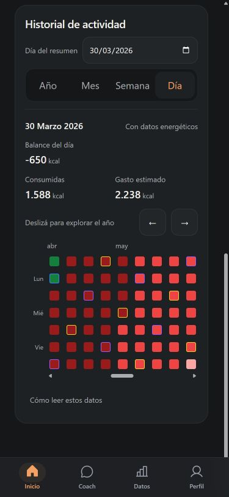

Tema claro: [375 px](screenshots/daily-heatmap-refinement-v8-1/after-day-375-light.jpg) y [1440×900](screenshots/daily-heatmap-refinement-v8-1/after-day-1440-light.jpg).

Comparación desktop:

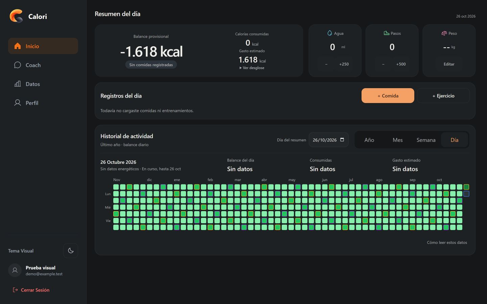

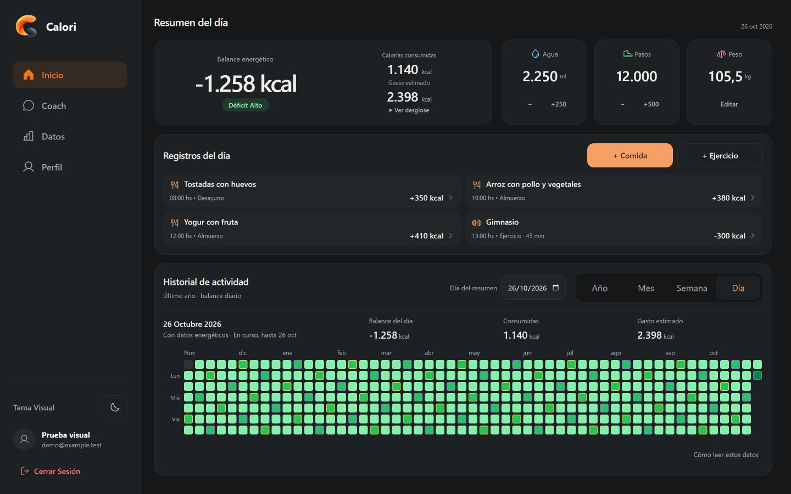

La [vista de 768×1024](screenshots/daily-heatmap-refinement-v8-1/after-day-768-dark.jpg) muestra el mismo calendario compacto en tablet. Las mediciones de los otros tamaños de escritorio figuran en la matriz responsive.

Vistas agrupadas sin rediseño: [Semana a 375 px](screenshots/daily-heatmap-refinement-v8-1/unchanged-Semana-375.jpg), [Mes a 375 px](screenshots/daily-heatmap-refinement-v8-1/unchanged-Mes-375.jpg) y [Año a 375 px](screenshots/daily-heatmap-refinement-v8-1/unchanged-Año-375.jpg).

## Límites y aprobación visual

Quedan para validación manual en dispositivos reales: precisión táctil con dedo, Safari/iOS, lector de pantalla, zoom nativo y texto ampliado del sistema. No se certifican esas experiencias a partir de atributos ARIA, de tests JSDOM ni de clics de puntero automatizados.

La comprobación autenticada del Preview remoto continúa pendiente; el estado Ready de un despliegue y la apertura pública de su página no equivalen a esa comprobación. No se modifica configuración remota para sustituirla.

La entrega permanece en el mismo PR #67 en borrador y espera aprobación visual. No hacer merge ni modificar Production automáticamente.
