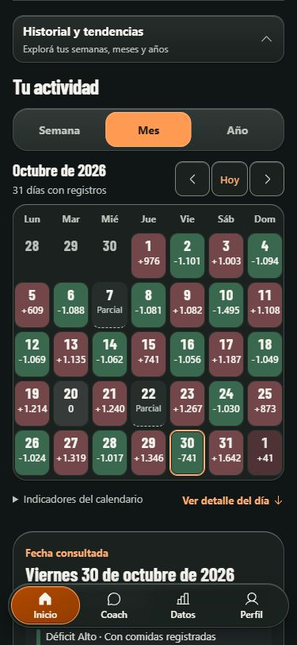
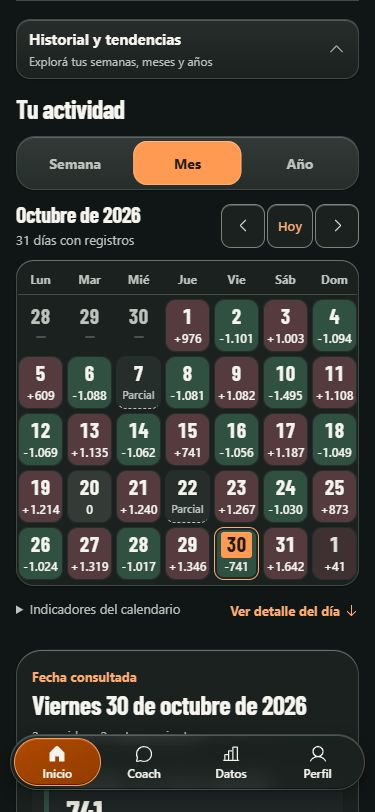
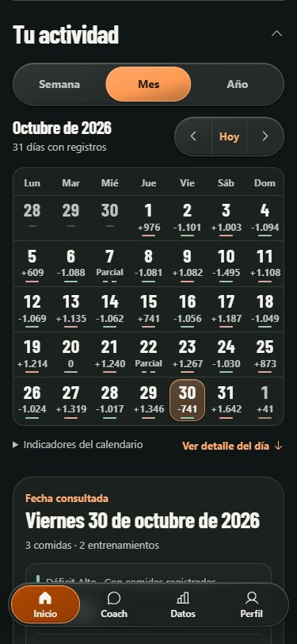

# Tu actividad · Evidencia de la iteración 2

La comparación usa el render de la aplicación en Chrome con los mismos datos sintéticos, dimensiones y reloj en las tres versiones. El servidor local materializa el código de Inicio 2D publicado en Production (`fb104d6c30832997e85f5e8fa8b211a0fafb162a`) y la primera iteración de 2E (`bc34cbb574434e418ac03eb0b43d9ca0335910bf`) en copias separadas. Los servicios externos quedan bloqueados y la revisión se hace sobre el origen local.

## Comparativas de octubre completo

Cada versión tiene capturas independientes de Semana, Mes y Año en 375 × 812 y 1440 × 900 px, en Claro y Oscuro. En móvil, las capturas adicionales de Año alcanzan el último tramo de la cuadrícula.



### 375 × 812 · Claro

- Semana · [2D](production/375-light-dense-semana.jpg) · [2E.1](first/375-light-dense-semana.jpg) · [2E.2](second/375-light-dense-semana.jpg)
- Mes · [2D](production/375-light-dense-mes.jpg) · [2E.1](first/375-light-dense-mes.jpg) · [2E.2](second/375-light-dense-mes.jpg)
- Año · [2D](production/375-light-dense-ano.jpg) · [2E.1](first/375-light-dense-ano.jpg) · [2E.2](second/375-light-dense-ano.jpg)

### 375 × 812 · Oscuro

- Semana · [2D](production/375-dark-dense-semana.jpg) · [2E.1](first/375-dark-dense-semana.jpg) · [2E.2](second/375-dark-dense-semana.jpg)
- Mes · [2D](production/375-dark-dense-mes.jpg) · [2E.1](first/375-dark-dense-mes.jpg) · [2E.2](second/375-dark-dense-mes.jpg)
- Año · [2D](production/375-dark-dense-ano.jpg) · [2E.1](first/375-dark-dense-ano.jpg) · [2E.2](second/375-dark-dense-ano.jpg)
- Año, tramo final · [2D](production/375-dark-dense-ano-final.jpg) · [2E.1](first/375-dark-dense-ano-final.jpg) · [2E.2](second/375-dark-dense-ano-final.jpg)

### 1440 × 900 · Claro

- Semana · [2D](production/1440-light-dense-semana.jpg) · [2E.1](first/1440-light-dense-semana.jpg) · [2E.2](second/1440-light-dense-semana.jpg)
- Mes y detalle · [2D](production/1440-light-dense-mes.jpg) · [2E.1](first/1440-light-dense-mes.jpg) · [2E.2](second/1440-light-dense-mes.jpg)
- Año · [2D](production/1440-light-dense-ano.jpg) · [2E.1](first/1440-light-dense-ano.jpg) · [2E.2](second/1440-light-dense-ano.jpg)

### 1440 × 900 · Oscuro

- Semana · [2D](production/1440-dark-dense-semana.jpg) · [2E.1](first/1440-dark-dense-semana.jpg) · [2E.2](second/1440-dark-dense-semana.jpg)
- Mes y detalle · [2D](production/1440-dark-dense-mes.jpg) · [2E.1](first/1440-dark-dense-mes.jpg) · [2E.2](second/1440-dark-dense-mes.jpg)
- Año · [2D](production/1440-dark-dense-ano.jpg) · [2E.1](first/1440-dark-dense-ano.jpg) · [2E.2](second/1440-dark-dense-ano.jpg)

## Noviembre sin registros y con pocos registros

Las galerías contienen ambos escenarios para cada período, ancho y tema. Los nombres incluyen `empty`, `sparse` o `dense`.

- Galerías completas · [2D](production/) · [2E.1](first/) · [2E.2](second/)
- Noviembre vacío, 375 px Claro · [2D](production/375-light-empty-mes.jpg) · [2E.1](first/375-light-empty-mes.jpg) · [2E.2](second/375-light-empty-mes.jpg)
- Noviembre escaso, 375 px Oscuro · [2D](production/375-dark-sparse-mes.jpg) · [2E.1](first/375-dark-sparse-mes.jpg) · [2E.2](second/375-dark-sparse-mes.jpg)
- Año escaso, 1440 px Claro · [2D](production/1440-light-sparse-ano.jpg) · [2E.1](first/1440-light-sparse-ano.jpg) · [2E.2](second/1440-light-sparse-ano.jpg)

El reloj local fija el 13 de noviembre de 2026. Octubre tiene 29 días con comidas, dos parciales, déficit y superávit alternados, un día neutro y registros del mes adyacente. La semana consultada cruza al 1 de noviembre. Julio, agosto, septiembre y octubre tienen densidades distintas. El caso escaso contiene una comida, un día parcial y una comida futura visible como registro de una fecha deshabilitada.

## Grabaciones de la aplicación

- [Móvil, 375 px, Oscuro](second/movimiento-375-dark.webm)
- [Escritorio, 1024 px, Claro](second/movimiento-1024-light.webm)

En los recorridos se seleccionan fechas consecutivas, se cambia de mes y se vuelve a Hoy. El selector cambia a Semana por teclado y a Año mediante clic. Después se abre octubre desde Año y se abre y cierra la leyenda. En móvil se enfoca el detalle al final.

## Ejecución reproducible

Levantar un servidor por vez. `--glass-home-2e-v2=production` y `--glass-home-2e-v2=first` archivan los SHA de referencia. La fase `second` usa el código del checkout. En las fases de referencia, el runner necesita `--before` y el puerto 5193. Para `second`, corresponde el puerto 5194.

```sh
# Referencia de Inicio 2D
node scripts/home-mobile/serve-qa.mjs --history-data --glass-home-2e-v2=production --port=5193
node scripts/fitness-global/liquid-glass-home-2e-v2-captures.mjs --iteration=production --before

# Primera iteración de 2E
node scripts/home-mobile/serve-qa.mjs --history-data --glass-home-2e-v2=first --port=5193
node scripts/fitness-global/liquid-glass-home-2e-v2-captures.mjs --iteration=first --before
node scripts/fitness-global/liquid-glass-home-2e.mjs --iteration=first --before --section=matriz --results=../home-2e-v2-first-chrome.json
node scripts/fitness-global/liquid-glass-home-2e.mjs --iteration=first --before --section=matriz --webkit --results=../home-2e-v2-first-webkit.json

# Segunda iteración de 2E
node scripts/home-mobile/serve-qa.mjs --history-data --glass-home-2e-v2=second --port=5194
node scripts/fitness-global/liquid-glass-home-2e-v2-captures.mjs --iteration=second --video --results=../home-2e-v2-motion.json
node scripts/fitness-global/liquid-glass-home-2e.mjs --iteration=second --section=matriz --reference=../home-2e-v2-first-chrome.json --results=../home-2e-v2-second-chrome.json
node scripts/fitness-global/liquid-glass-home-2e.mjs --iteration=second --section=matriz --webkit --reference=../home-2e-v2-first-webkit.json --results=../home-2e-v2-second-webkit.json
```

`PLAYWRIGHT_MODULE` permite usar un módulo Playwright disponible y `PLAYWRIGHT_BROWSERS_PATH` ubicar el binario WebKit y el grabador. `--only=375-dark` concentra las capturas en un tamaño y tema y `--scenario=sparse` vuelve a capturar solo el escenario escaso. El runner acepta los resultados de la validación previa de 2E.1 como referencia de Inicio y deja el encabezado móvil fuera de esa comparación porque tiene su propia prueba de teclado.

## Alcance de las mediciones

La matriz comprueba los siete anchos de 320 a 1440 px por tema, escala de texto y período. Incluye navegación con Tab y flechas, blancos táctiles, contraste sobre fondos capturados, controles sobre la cápsula, movimiento reducido, límites de calendario y la separación entre la fecha explorada y la editable. El caso de Hoy comprueba que el domingo se revele dentro del calendario a 320 px, con foco y posición vertical conservados. Las cifras y el resultado de la matriz del candidato se registran en el PR.

El muestreo de movimiento usa `requestAnimationFrame` en Chrome de escritorio durante la grabación. Incluye las esperas del guion y la carga de codificación. El intervalo p95 fue de 17 ms por interacción en ambos recorridos. Los máximos observados fueron 133 ms a 375 px y 217 ms a 1024 px, durante cambios de período. La cadencia, la interacción con barras dinámicas y los gestos de Safari en iPhone físico requieren revisión en el dispositivo.
