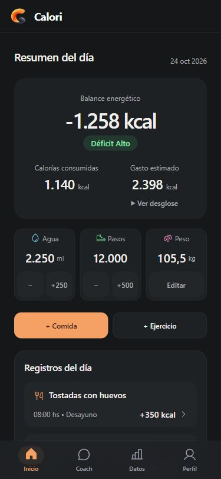
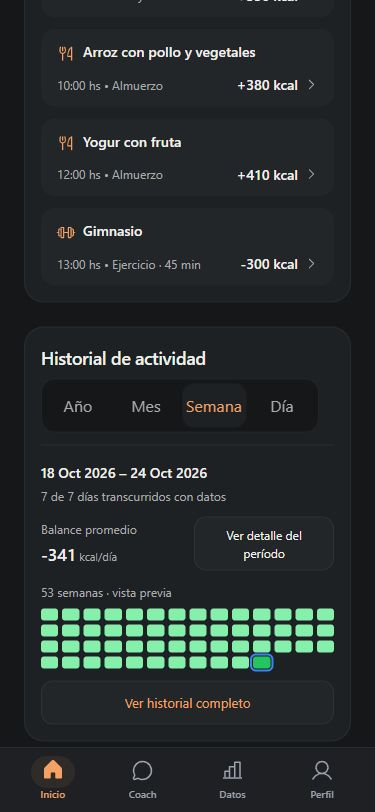
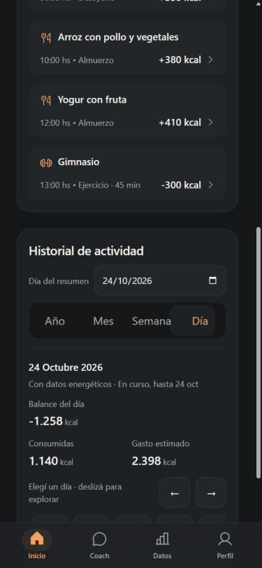
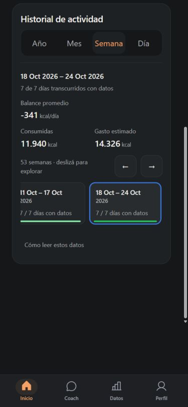
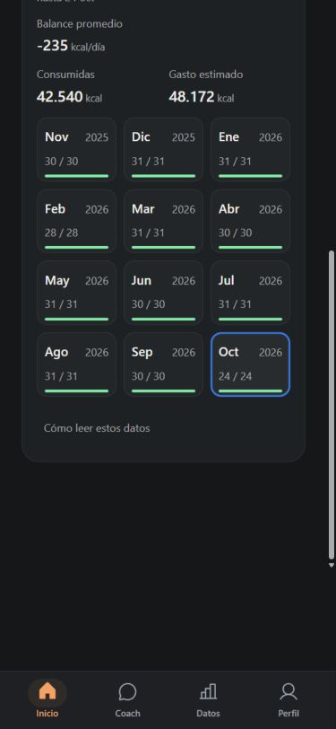
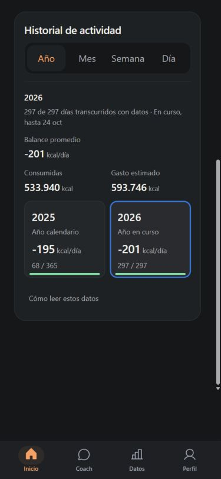
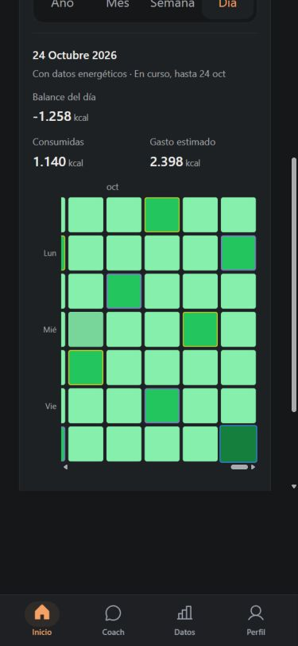
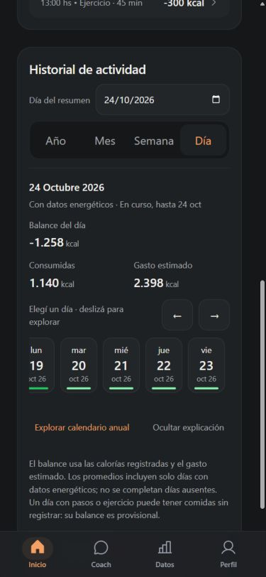
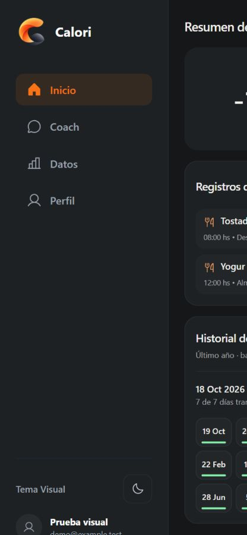
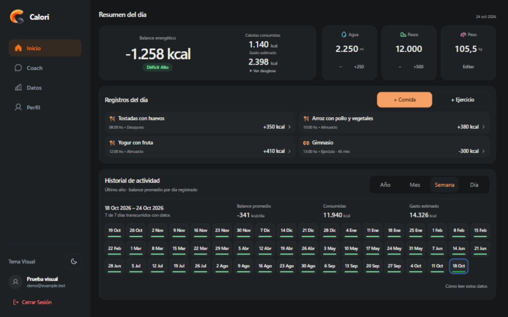

# Calori Premium V8 — Frictionless History Experience

Base auditada: `main` en `a6cd5df78284fecccdc84cce8420228d0aa6477d`, con Premium V7 (PR #66) integrado. Rama: `codex/frictionless-history-ux-v8`.

[PR #67 en borrador](https://github.com/MateoLitrenta/calori-tracker/pull/67) hacia main. [Preview de la rama V8](https://calori-tracker-git-code-87e5e2-mateolitrenta-gmailcoms-projects.vercel.app). Vercel confirmó Ready para el código de los checkpoints A/B; el estado del commit final se comprueba en los checks del PR. Las pruebas visuales de Inicio son locales con fixtures y no equivalen a una sesión autenticada en ese Preview. No se ha hecho merge ni modificado Production.

## Problema comprobado y alcance

La versión V7 compacta dibujaba la vista previa con elementos `span` dentro de un contenedor `role="img"`. Los botones que modificaban la selección estaban en una visualización diferente, oculta en móvil hasta pulsar «Ver historial completo». La inspección previa del navegador a 375 px confirmó cero botones de período visibles y una vista previa pasiva. Esto explicaba que tocar sus celdas no actualizara el resumen.

El cambio queda limitado a Inicio: `Heatmap.tsx` y `HomeVariants.css`. Las regresiones están en `history-experience.test.mjs`, `precision-layout.test.mjs` y `ui-polish.test.mjs`; este último completa el mock de `matchMedia` que necesitan los componentes reales. La documentación y las capturas acompañan estos archivos. No se modifican DailyPanel, HomeView, helpers energéticos, persistencia, validaciones, endpoints, autenticación, IA, cuotas, objetivos ni migraciones. Tampoco se rediseñan Datos, Perfil o Coach. No hay nuevas dependencias.

## Checkpoint A — selección directa

Commit de implementación local: `22af488` (publicado; equivalente local `a5b0551`).

Se elimina la vista previa pasiva. Semana, Mes y Año reutilizan un único conjunto de botones, con la misma selección y las mismas agregaciones en todas las resoluciones. No hay una implementación móvil independiente que pueda divergir de desktop.

Día incorpora una cinta de botones semánticos con día de semana, número, mes y año. La cinta y el calendario anual comparten el generador de botones, `selectedDateStr` y el flujo existente `onSelectDate`. La selección de un día actualiza el resumen diario de Inicio. Las selecciones agrupadas usan exclusivamente `selection[period]`: consultar una semana, mes o año no cambia el día ni el destino de guardado de Inicio.

El resumen contextual muestra inmediatamente período, cobertura, balance, calorías consumidas y gasto estimado. Las tres cifras principales permanecen visibles sin abrir un detalle. Las flechas recorren los botones; Inicio/Fin llevan a los extremos. Mover el foco no selecciona automáticamente: la activación usa el botón nativo mediante Enter o Espacio.

## Checkpoint B — simplificación de acceso y responsive

Commit de implementación local: `80f0627` (publicado; equivalente local `565f353`).

La presentación compacta funciona hasta 1023 px, incluyendo tablet. Cada escala tiene una geometría apropiada:

- Día utiliza una cinta horizontal de fechas con controles explícitos para avanzar o retroceder, además del input de fecha. «Explorar calendario anual» permite consultar el calendario completo; «Volver a la cinta de días» lo contrae. No es necesario expandirlo para seleccionar fechas.
- Semana utiliza una cinta horizontal de 53 intervalos. Cada tarjeta muestra el rango temporal, año, cobertura y una franja con el color semántico existente del balance. La selección tiene borde visible. Hay indicación de desplazamiento y botones de navegación; el gesto no es el único acceso. La scrollbar visual se oculta dentro de ese scrollport, sin permitir scroll horizontal de la página.
- Mes muestra los doce meses en tres columnas compactas con etiquetas y año. Sus botones crecen naturalmente si el contenido lo requiere.
- Año conserva los dos años originales, con balance promedio, cobertura y estado del período consultado. Los bloques se seleccionan directamente.

La expansión de visualización se ofrece solo para el calendario anual de Día. Ya no hay un botón «historial completo» en Semana, Mes o Año. «Cómo leer estos datos» es una acción secundaria que muestra el método, las leyendas y el balance acumulado de períodos agrupados; no oculta las cifras principales. No se eliminó el balance acumulado ni información existente.

La selección y las expansiones siguen siendo estados independientes. El desplazamiento se recuerda por superficie, escala y presentación compacta/amplia. Las superficies ocultas o sin overflow no sobrescriben la posición explorada. Al regresar a una escala o redimensionar, se restaura la posición correspondiente. Seleccionar un elemento visible no recentra la cinta constantemente. Un salto explícito mediante fecha o calendario anual revela la fecha seleccionada una vez en la cinta cuando corresponde.

Los clics del historial se aíslan dentro de su sección para que el listener de clic exterior del formulario de DailyPanel no cierre ni borre los borradores. No se modifica el guardado para resolver este comportamiento.

## Significado de los datos

`aggregateEnergy` y `getNetBalance` siguen siendo las fuentes oficiales. V8 no reconstruye promedios, no rellena días ausentes, no cambia TMB ni gasto y no agrega comparaciones energéticas nuevas.

En Día, el balance corresponde al día seleccionado y usa kcal. En Semana, Mes y Año, la cifra principal es el balance promedio por día registrado y usa kcal/día. Consumidas y Gasto estimado son los totales oficiales del período; no son promedios diarios. El balance acumulado se conserva en la explicación secundaria.

La cobertura expresa los días transcurridos con datos energéticos. Si faltan días se añade «Cobertura parcial»; el extremo temporal existente determina «En curso». «Con datos» no afirma que todas las comidas hayan sido registradas. Un intervalo sin datos conserva `null` y se presenta como «Sin datos», sin convertirlo en consumo cero confirmado.

Pasos o ejercicio pueden aportar datos energéticos en un día sin comidas. En ese caso se informa «Balance provisional» y «Sin comidas registradas»; si el total registrado de consumo es cero, se califica como «0 kcal registradas». El número oficial de balance y gasto permanece idéntico. La etiqueta describe la limitación de los registros y no inventa ingesta real.

## Medición de acciones antes y después

El punto de partida de esta comparación es la escala deseada ya activa, el historial compacto y un período objetivo visible. Se cuenta una activación de control como una acción; deslizar para encontrar un período fuera de vista es navegación adicional, no se cuenta como si todos los períodos estuvieran simultáneamente visibles.

- Otra semana: V7 requería abrir el historial completo y seleccionar, dos acciones. V8 requiere tocar la semana, una acción.
- Otro mes: dos acciones en V7 y una en V8.
- Otro año: dos acciones en V7 y una en V8.
- Otro día visible: abrir el calendario y seleccionar, dos acciones en V7; tocar la fecha en la cinta, una en V8.
- Balance del período elegido: se obtiene con la misma selección; dos acciones desde el compacto de V7 y una en V8.
- Consumidas y Gasto estimado del período elegido: V7 necesitaba además «Ver detalle del período», tres acciones desde el estado inicial descrito. V8 las muestra con la selección, una acción.
- Calendario anual desde Día: una acción en ambas versiones. En V8 su nombre describe el acceso específico y no actúa como puerta de entrada a la selección básica.

Si hay que cambiar de escala, se añade una acción a ambos recorridos. En V7, una vez abierto el historial completo, selecciones posteriores ya podían realizarse en una acción; la mejora elimina ese requisito inicial y mantiene la información principal disponible.

## Validación visual y geometría

Las capturas y mediciones utilizan los componentes verdaderos en navegador con datos sintéticos. El escenario normal tiene tres comidas y un entrenamiento; autenticación, base de datos e IA se simulan localmente. No se usaron datos personales ni se enviaron registros a servicios remotos. JSDOM no se presenta como una herramienta de medición geométrica.

La [matriz final](screenshots/frictionless-history-ux-v8/final-responsive-matrix.json) contiene 64 combinaciones: las cuatro escalas, los temas claro y oscuro, y estas ocho resoluciones: 1920×1080, 1440×900, 1366×768, 1280×720, 768×1024, 430×932, 375×812 y 320×740. Ninguna presenta overflow horizontal global.

En 1440×900, con los cuatro registros normales y la explicación contraída, las cuatro escalas mantienen `scrollHeight = clientHeight = 900`, en ambos temas. No se ha usado escala CSS ni recorte para conseguirlo. Desktop conserva el calendario completo y su estructura de tres filas.

En 1366×768 se midieron scrollHeight de 845/889/863/833 px para Día/Semana/Mes/Año. En 1280×720 fueron 833/889/874/833 px. Esos tamaños requieren scroll vertical natural; no se afirma que todo quepa en notebooks. La página mantiene cifras legibles y controles accesibles.

En móvil, las tarjetas de mes y el resumen ocupan más espacio que la vista previa pasiva anterior: ahora son controles reales con información y targets cómodos. Se prioriza la consulta directa, sin volver a compactar mediante celdas diminutas. A 320 px, los textos o cifras que necesitan más líneas crecen en el flujo normal. No hay una altura fija que oculte esos contenidos.

Los nuevos controles compactos, las flechas y las tarjetas agrupadas medidos conservan al menos 44×44 px. El calendario anual expandido en móvil tiene celdas de 44 px y scroll horizontal local. El calendario anual de escritorio conserva su geometría previa y la alternativa de fecha. En las filas Día desktop, `targets: null` indica que no hay controles compactos o agrupados aplicables a ese muestreo; las celdas del calendario conservan su tamaño previo.

La matriz corresponde al estado compacto y no demuestra por sí sola el calendario anual abierto. Ese estado cuenta con captura y comprobación separadas. Las expansiones aumentan la altura natural de la sección, sin reservar previamente un bloque vacío.

En navegador se activaron semanas mediante Enter y Espacio, y días mediante Espacio. Las flechas movieron el foco sin seleccionar hasta la activación nativa. El selector nativo de fecha respondió con ArrowUp y sincronizó Inicio; un salto al 10 de febrero desde el calendario anual conservó esa fecha al volver a la cinta y la mostró dentro de su viewport. La automatización de fill sobre input date solo cambió el DOM y no se contó como una activación válida de React. [Interacciones y límites](screenshots/frictionless-history-ux-v8/interactions.json).

Se comprobaron también fixtures vacíos, con cinco días registrados y con cifras de siete dígitos, 32 registros y texto largo sin espacios. [Cifras grandes: 12 combinaciones sin overflow](screenshots/frictionless-history-ux-v8/scenario-large.json). Las capturas de [ausencia de datos](screenshots/frictionless-history-ux-v8/empty-Día-375.jpg), [cobertura parcial](screenshots/frictionless-history-ux-v8/sparse-Semana-375.jpg) y [cifras grandes](screenshots/frictionless-history-ux-v8/large-Año-375.jpg) muestran los estados reales del fixture. Los períodos vacíos conservan valores desconocidos; el cero no se presenta como ingesta confirmada.

Un recorrido largo del navegador agotó la espera y se repitió en bloques acotados. La actualización posterior del entorno también cerró el servidor local. Estas interrupciones no se contaron como pruebas aprobadas ni motivaron cambios funcionales.

## Checkpoint C — regresiones y validaciones

Se añadieron regresiones sobre selección directa sin expansión, valores oficiales inmediatos, intervalo independiente por escala, conservación del día consultado, borradores de comidas y ejercicios, ausencia de escrituras al navegar, exploración anual, selección compartida entre cinta y calendario, restauración de scroll, saltos de fecha, foco, ARIA y recorrido de teclado. Los contratos de estilos cubren controles accesibles en móvil y tablet, visualización completa en desktop, foco, movimiento reducido y superficies de scroll acotadas.

Los estados vacíos, cobertura parcial y balance provisional se contrastan con los mismos helpers oficiales. Las pruebas no sustituyen números por expectativas visuales ni reducen las validaciones existentes para obtener un resultado positivo.

Suite completa: **352/352 pruebas aprobadas**, sin fallos, cancelaciones ni omisiones. Los tres lotes independientes cubren exactamente los 31 archivos: 136 + 127 + 89. Incluyen PostgreSQL/RLS nativo y la carga del artefacto serverless mediante HTTP. [Manifiesto](screenshots/frictionless-history-ux-v8/test-manifest.json) y [resultados](screenshots/frictionless-history-ux-v8/validation-summary.json).

TypeScript frontend, api/ai y api/coach, lint, build y git diff --check aprobados. Permanecen 11 advertencias previas de lint y el aviso de chunk grande.

Los primeros intentos de dos lotes fallaron por un mock JSDOM sin matchMedia y por un directorio temporal de PostgreSQL inexistente. Se completó el mock conservando las aserciones y se preparó el directorio descartable; ambos lotes completos volvieron a pasar. No se tocaron código backend, reglas ni timeouts para resolverlos.

## Capturas antes y después

Las imágenes muestran fixtures locales; no demuestran una sesión autenticada en el Preview remoto.

Antes, Día y Semana a 375 px:

Después, selección directa y resumen inmediato a 375 px:

Exploración anual y explicación secundaria:

Vistas finales de 320 px: [Día](screenshots/frictionless-history-ux-v8/after-Día-320.jpg), [Semana](screenshots/frictionless-history-ux-v8/after-Semana-320.jpg), [Mes](screenshots/frictionless-history-ux-v8/after-Mes-320.jpg) y [Año](screenshots/frictionless-history-ux-v8/after-Año-320.jpg).

Comparación desktop 1440×900:

Las demás escalas desktop: [Día](screenshots/frictionless-history-ux-v8/after-Día-1440.jpg), [Mes](screenshots/frictionless-history-ux-v8/after-Mes-1440.jpg) y [Año](screenshots/frictionless-history-ux-v8/after-Año-1440.jpg). Tema claro: [Semana a 375 px](screenshots/frictionless-history-ux-v8/light-Semana-375.jpg) y [Semana a 1440×900](screenshots/frictionless-history-ux-v8/light-Semana-1440.jpg).

## Límites y aprobación pendiente

La validación en navegador local es real; las fuentes de datos y servicios son fixtures. No se afirma persistencia, autenticación o IA verificadas en Production. La comprobación pública del Preview se documentará junto con su estado, sin confundirla con una sesión autenticada.

Quedan para validación manual en dispositivos: Safari/iOS, teclado virtual real, zoom nativo y cambios de tamaño de texto del sistema, lector de pantalla y sesión autenticada en Preview. Los botones, foco y movimiento reducido están implementados y cubiertos por comprobaciones específicas, pero esos atributos no equivalen a certificar toda la experiencia asistiva.

Se espera aprobación visual del PR en borrador. No hacer merge ni modificar Production automáticamente.
