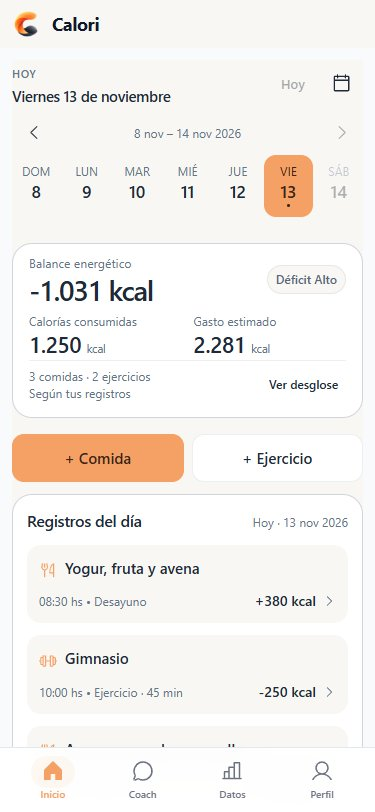
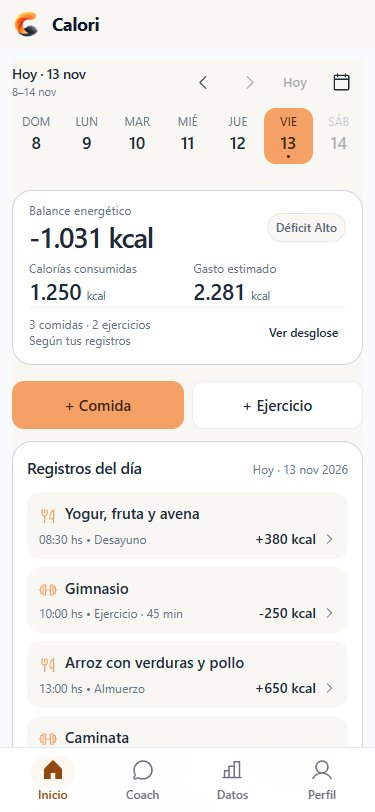
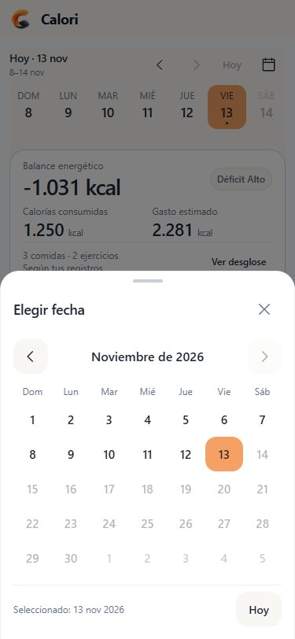

# Inicio · refinamiento del PR #79

La referencia es el propio borrador `fe01ecb`. La comparación usa la misma cuenta sintética, fecha local, datos y tamaño de ventana en Chrome para las dos versiones. El [informe anterior](ux-v10-1-1-mobile-home.md) conserva la comparación con main.

## Auditoría inicial y decisiones

- **Alta · Fecha fuera de la semana.** El botón mensual desplaza el contenido hasta Historial. Consultar un día de octubre desde el viernes 13 de noviembre exige abrir el calendario, ir al mes anterior, elegir el día y abrir sus registros. Separar la elección de fecha de la exploración de tendencias permite seleccionar directamente y conservar el punto de lectura. Una edición activa debe conservar el formulario, la fecha de escritura y su borrador.
- **Alta · Interpretación del balance.** En un día vacío, la estimación basal puede producir una cifra negativa grande aun con cero comidas y cero actividades. La cifra ocupa el lugar de un resultado diario. Priorizar la falta de registros en el resumen y mantener el cálculo consultable en el desglose. Para actividad sin comidas, hacer visible el carácter provisional.
- **Media · Fechas y teclado.** En la captura original de 320 px las celdas semanales miden unos 39 px de ancho. Dar prioridad al objetivo táctil de 44 px, con desplazamiento local cuando sea necesario. Conservar domingo como primer día porque Historial ya lo usa para el calendario, los períodos y las teclas Inicio/Fin. El día seleccionado y Hoy comunican dos conceptos distintos.
- **Media · Registros y hábitos.** La lista repite superficies con margen amplio por cada registro. A 320 px la unidad de agua desplaza los botones por debajo de los de pasos. Ajustar la densidad de la lista, alinear unidades y botones y conservar el área pulsable de toda la fila.
- **Media · Sección activa.** El texto de Inicio en la barra inferior usa el mismo naranja claro del relleno de acento, sobre blanco, con un tamaño de 10 px. Usar tinta naranja de mayor contraste para texto y foco en claro, subir la etiqueta a 12 px y exponer la ubicación actual también en la navegación de escritorio.
- **Baja · Cabecera y acciones.** La marca ya ocupa 48 px y Comida/Ejercicio ya superan 44 px de alto. Conservar ambos accesos visibles y evitar una segunda barra fija. Mantener la confirmación y los estados de fallo existentes. Aplicar los cambios de composición a través de los radios, superficies y colores que Inicio ya comparte.

## Reproducción

Con dependencias del proyecto instaladas, ejecutar en dos terminales `node scripts/home-mobile/serve-qa.mjs --before-refinement` y `node scripts/home-mobile/serve-qa.mjs --refinement`. Los puertos locales son 5183 y 5184. La fecha sintética es el 13/11/2026 en Buenos Aires. El control de acceso, el escritor y el transporte de IA están sustituidos en estos servidores de prueba. La aplicación desplegada conserva sus entradas normales.

El script `scripts/home-mobile/audit-responsive.mjs` abre Chrome aislado con Playwright suministrado por el entorno de pruebas, opcionalmente mediante `PLAYWRIGHT_MODULE`. Usar `--before-refinement` para la referencia y ejecutar sin argumentos para la candidata. Genera las [capturas y medidas](evidence/v10-1-1-refinement) en seis anchos y dos temas.

## Resultado de diseño

En Inicio móvil, la fecha y los controles de semana comparten una línea. El botón mensual abre «Elegir fecha» en una hoja inferior. En escritorio abre un cuadro de diálogo centrado. Recorrer meses o mover el foco con las flechas conserva la fecha de los registros hasta elegir un día. El calendario comparte la transición de fecha y los límites del selector semanal. Historial conserva su propia navegación. El formulario abierto conserva prioridad sobre ambos selectores.

Las filas de registros mantienen el título, la hora, el tipo y las calorías con menos separación vertical. El detalle muestra su fecha y reutiliza el contenedor de formularios para el cierre, el foco y las acciones. Los valores y unidades de los hábitos usan dos filas alineadas. Las acciones de sumar, restar y editar siguen disponibles a la vista. La navegación inferior mantiene el icono relleno de la sección activa y usa un color de texto distinto para cada tema.

**Comparación móvil, 375 px**

  

[Antes en oscuro](evidence/v10-1-1-refinement/before-375-dark.jpg) · [Después en oscuro](evidence/v10-1-1-refinement/after-375-dark.jpg) · [Calendario en escritorio](evidence/v10-1-1-refinement/calendar-1440-dark.jpg) · [Todas las capturas](evidence/v10-1-1-refinement).

La revisión en navegador detectó una colisión entre las claves de React del panel y del calendario. Aunque Escape actualizaba el estado, el diálogo podía seguir visible. Se corrigió la identidad de los componentes y se incorporó una comprobación de cierre real y retorno de foco. También se distinguieron Hoy y el día seleccionado cuando son distintos, se mantuvo el color de selección bajo el puntero y se explicitó el mes al mostrar semanas que cruzan su límite.

## Mediciones de la segunda auditoría

| Tarea o medida | PR anterior | Refinamiento |
| --- | --- | --- |
| Abrir el registro de otra fecha del mes anterior | Calendario, navegar, elegir y abrir registros en Historial | Calendario, mes anterior y día. Tres toques y 0 px de desplazamiento de Inicio en la prueba |
| Selector semanal a 375 px | 157 px de alto | 104 px |
| Inicio de las acciones a 375 px | Y = 434 px | Y = 381 px |
| Primera fila con el mismo registro a 375 px | 79 px de alto | 67 px |
| Día de la semana a 320 px en Chrome de pruebas | 41 px de ancho | 44 px. El botón mensual de cada día también alcanza 44 × 44 px |
| Texto de la pestaña activa en tema claro móvil | Contraste aproximado 2,08:1 | 6,69:1 |

En las doce combinaciones el documento y el área principal cupieron en el ancho disponible. En las doce, el calendario retuvo el foco, Escape cerró el diálogo y lo devolvió al botón que lo abrió. La comparación de contraste utiliza los colores CSS compuestos de las superficies planas muestreadas. Estas mediciones describen los fixtures y los tamaños ensayados. Los recorridos se hicieron en Chrome con teclado y ventanas de prueba; queda pendiente la observación con usuarios, lectores de pantalla y dispositivos físicos, especialmente Safari/iOS.

Los resultados y dimensiones individuales están en [referencia](evidence/v10-1-1-refinement/before-responsive.json) y [candidata](evidence/v10-1-1-refinement/after-responsive.json).

## Recorridos funcionales

Con el servidor de la candidata activo, ejecutar `node scripts/home-mobile/audit-journeys.mjs` con el mismo Chrome y Playwright. Cada caso abre un contexto aislado. Las once variantes de los ocho recorridos aprobaron, con cero errores de consola o de página, llamadas de IA o solicitudes externas. Los conteos representan acciones del guion y los importes corresponden a datos sintéticos. [Resultados por paso y capturas](evidence/v10-1-1-refinement/journeys.json).

| Recorrido | Resultado observado |
| --- | --- |
| A · Comprender el balance | Desde la entrada se ven 1.250 kcal consumidas, 2.281 kcal de gasto estimado y un balance de −1.031 kcal. Cero acciones para consultar los tres valores. |
| B · Registrar comida | Dos toques y tres campos. Se confirmó un único registro para Hoy. |
| C · Modificar ayer | Cuatro toques y una edición. La única escritura correspondió a ayer y los datos de Hoy conservaron sus valores. |
| D · Consultar otro mes | Tres toques para pasar del 13 de noviembre al 31 de octubre y dos más para probar el regreso a Hoy. El desplazamiento de Inicio fue 0 px. Los días futuros estaban deshabilitados. |
| E · Registrar hábitos | Tres toques, una edición y Enter para sumar agua y pasos y guardar 73,6 kg. Se verificaron las tres escrituras a 320 y 375 px. Los hábitos requieren bajar por la pantalla, 685 y 401 px respectivamente en estos fixtures. |
| F · Explorar Historial y volver | Seis toques para explorar ayer, abrir sus registros, volver a la actividad y pasar por Datos e Inicio. La fecha cambió al abrir los registros explícitamente. Cero escrituras. |
| G · Día vacío y día parcial | Un toque para consultar cada día. El vacío informa «Sin datos de energía». Con actividad y sin comidas aparece un balance provisional. |
| H · Recuperar un borrador | En escritorio se conservaron el texto y la fecha al intentar usar los dos selectores. La recuperación devolvió el foco al formulario. En móvil el fondo quedó inerte y doce pulsaciones Tab permanecieron dentro de la hoja. |

La CI Linux del repositorio verifica la regresión y los datos de ensayo en servicios desechables. La Preview permite revisar la compilación publicada con la protección del proyecto. Las capturas y las escrituras de estos recorridos proceden del entorno local sintético. El detalle de CI y el enlace a la Preview del commit revisado se encuentran en el [PR #79](https://github.com/MateoLitrenta/calori-tracker/pull/79).
