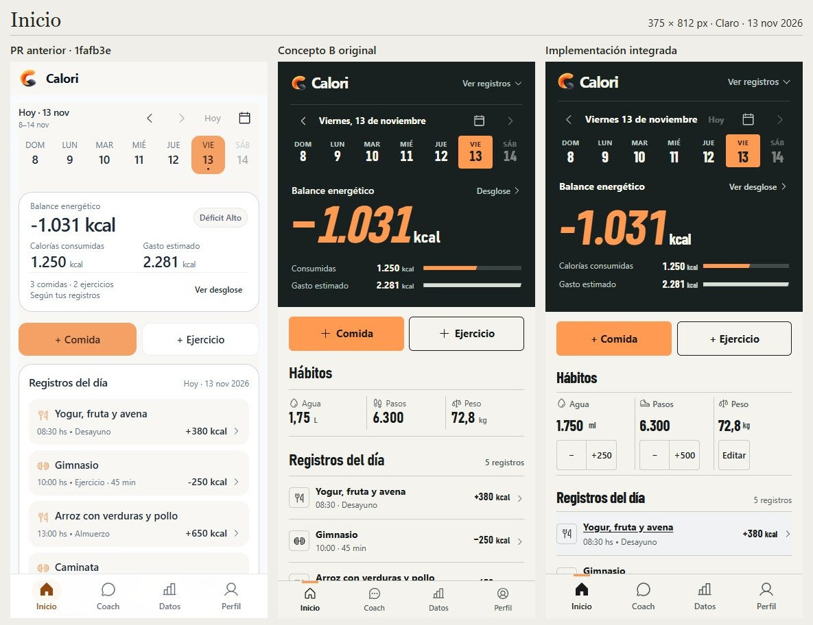

# Inicio · Fitness Moderno

## Decisiones antes de implementar

La base de comparación es el PR #79 en `1fafb3e`. La referencia visual es el prototipo B original de la galería local, con su hoja de estilos, su estructura y sus capturas. Las tres columnas de la revisión mostrarán la misma fecha y el mismo perfil sintético.

| Elemento de B | Adaptación en Calori |
| --- | --- |
| Marcador grafito con semana, saldo naranja y dos barras | Integrar visualmente la marca, WeeklyDateNav y el balance de DailyPanel. Representar consumo registrado y gasto estimado en la misma escala diaria, con cifras y explicación en el desglose. Mantener los estados vacío y provisional. |
| Acciones de alta debajo del marcador | Mantener Comida y Ejercicio a un toque. Usar botón naranja y botón de contorno. |
| Franja de hábitos y lista cronológica | Situar agua, pasos y peso antes de la lista en móvil. Conservar la edición, los controles rápidos y el estado de guardado. Ofrecer un acceso directo a los registros. |
| Hojas con cabecera grafito y campos agrupados | Aplicar el lenguaje a los formularios reales de alta y edición y al calendario mensual. Mantener datos, fotos, estimación opcional, validaciones, foco y borradores existentes. |
| Adaptación al espacio | Aprovechar el ancho disponible en escritorio. Verificar los seis anchos solicitados en ambos temas y revisar la primera pantalla, los hábitos, los registros y los formularios por separado. |

## Comparación a 375 px

De izquierda a derecha aparecen el PR anterior, el concepto B y la aplicación integrada. Las tres vistas muestran el 13 de noviembre de 2026, con el mismo perfil, comidas, ejercicios, agua, pasos y peso.

[Inicio oscuro](evidence/fitness-moderno/compare-home-dark.jpg) · [Hábitos](evidence/fitness-moderno/compare-habits-light.jpg) · [Registros](evidence/fitness-moderno/compare-records-light.jpg) · [Calendario](evidence/fitness-moderno/compare-calendar-dark.jpg) · [Comida](evidence/fitness-moderno/compare-meal-light.jpg) · [Ejercicio](evidence/fitness-moderno/compare-exercise-dark.jpg).

Con los datos de ejemplo se leen 1.250 kcal consumidas, 2.281 kcal de gasto estimado y un balance de −1.031 kcal. La barra más larga representa la mayor de las dos cifras del día. El desglose permite consultar el metabolismo basal, los pasos, el ejercicio y la explicación de la escala. Un día vacío indica que faltan datos y la actividad sin comidas muestra un balance provisional.

El selector y el balance forman una franja continua. La tipografía condensada se sirve desde el proyecto en dos archivos WOFF2 con licencia OFL. En móvil, los hábitos aparecen antes de la lista y mantienen la edición y los botones de ajuste. Estos controles ocupan más espacio que los indicadores del prototipo. El acceso «Ver registros» lleva directamente al encabezado de la lista. En escritorio, las acciones y hábitos comparten la columna izquierda, con los registros a la derecha y el Historial debajo.

Los formularios conservan la fecha, los campos de alimentación y entrenamiento, la foto, el comando de estimación y las confirmaciones. Se corrigió en la revisión visual una superposición de Calorías y Hora, y en la revisión funcional se restituyeron Distancia y Ritmo en la edición de ejercicio.

## Alcance de las pruebas

La matriz de Chrome cubre 320, 375, 393, 440, 768 y 1440 px en claro y oscuro. Las pantallas integradas usan App, HomeView, DailyPanel, los selectores y los formularios React del producto. El escritor, la sesión, Storage y el transporte de IA son dobles locales con datos sintéticos. La referencia B conserva su ancho móvil de 393 px en los lienzos de escritorio. [Mediciones antes](evidence/fitness-moderno/before.json) · [Prototipo](evidence/fitness-moderno/concept.json) · [Integración](evidence/fitness-moderno/integrated.json).

Los recorridos incluyen navegar por semanas y meses, completar y editar comidas y ejercicios, cancelar o confirmar eliminaciones, registrar los tres hábitos, recuperar borradores, reintentar un fallo de guardado y alternar entre dos cuentas. Las comprobaciones de geometría complementan las de interacción y foco. [Resultados de los recorridos](evidence/fitness-moderno/journeys/journeys.json).

A 375 px en tema claro, el primer botón de alta comienza a 379 px del borde superior, frente a 372 px en B. Los hábitos comienzan a 447 px, frente a 443 px en B y 888 px en el PR anterior. La lista comienza a 622 px, frente a 570 px en B, porque se conservaron los controles rápidos de la aplicación. En las doce combinaciones, Escape cerró el calendario y devolvió el foco a su disparador. Las 48 combinaciones de formulario, modo de edición, ancho y tema mantuvieron separadas las etiquetas y los controles medidos.

La revisión adicional de campos opcionales expandidos comprobó foto y notas, distancia y ritmo en 48 configuraciones. La separación mínima entre los campos medidos fue de 8 px. Al activar «Ver registros» con Enter a 320 y 375 px, el foco pasó al encabezado y Tab permitió abrir la primera fila. El contraste medido de la cifra principal fue 7,88:1 en claro y 7,24:1 en oscuro. [Geometría de los formularios](evidence/fitness-moderno/formularios.json).

### Reproducción

Con las dependencias del proyecto y Chrome instalados, iniciar `node scripts/home-mobile/serve-qa.mjs --before-fitness` y `node scripts/home-mobile/serve-qa.mjs --fitness` en terminales separadas. Con Playwright disponible mediante `PLAYWRIGHT_MODULE`, ejecutar `node scripts/home-mobile/compare-fitness.mjs before concept integrated boards` y `node scripts/home-mobile/audit-journeys.mjs --fitness`. Para volver a capturar el prototipo se necesita la galería de exploración local, con `CALORI_B_HTML` apuntando a su archivo `phone.html`. Las capturas versionadas se pueden consultar sin la galería.

Los resultados Linux y el despliegue de Preview del commit revisado figuran en el [PR #79](https://github.com/MateoLitrenta/calori-tracker/pull/79). La validación de uso con Safari y teclados físicos y las integraciones remotas con credenciales reales quedan fuera de estas pruebas locales.
