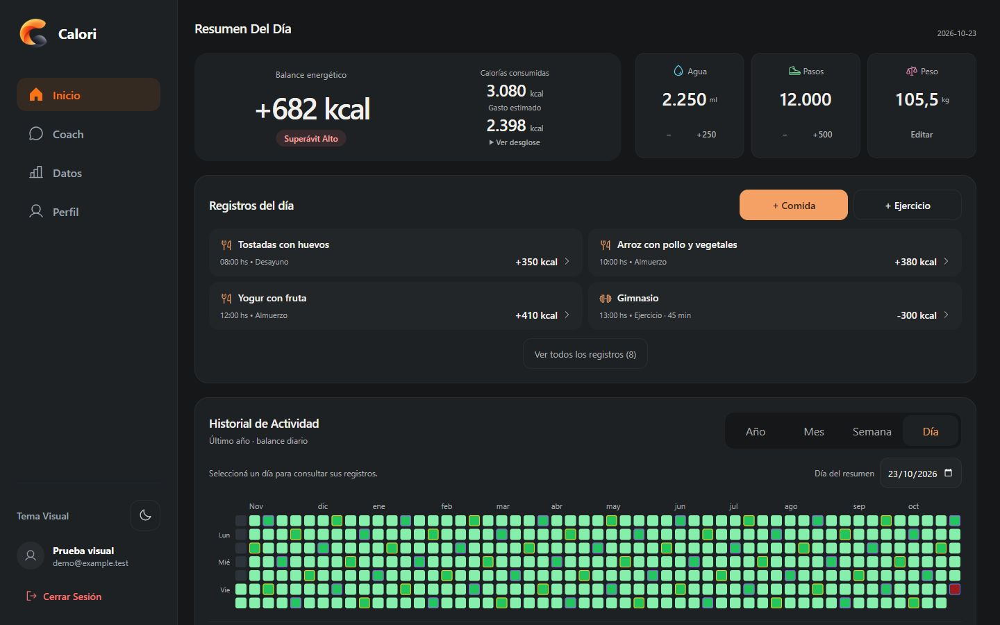
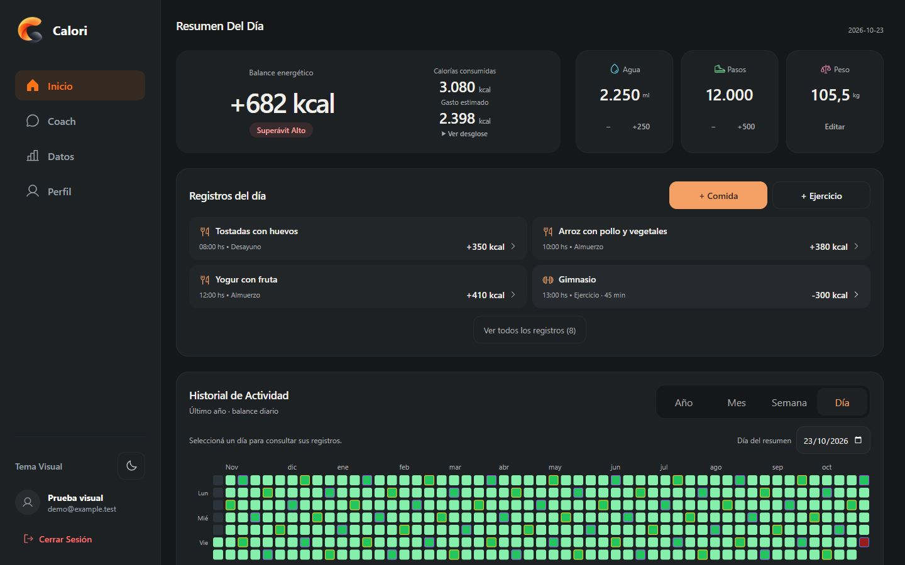
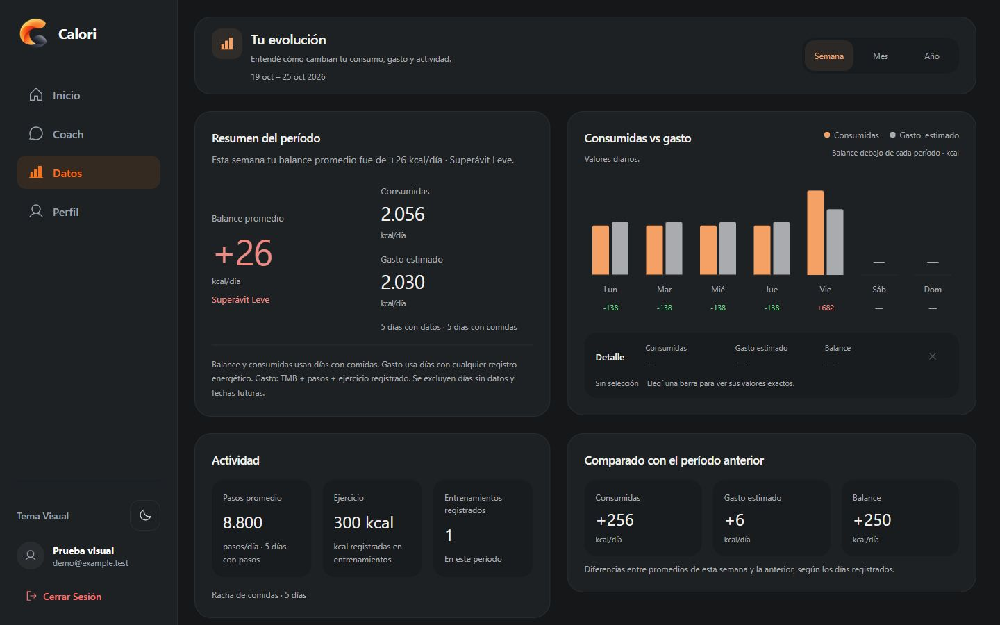
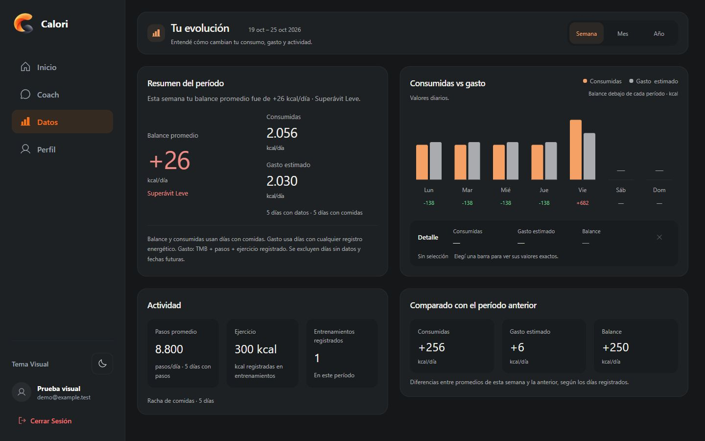
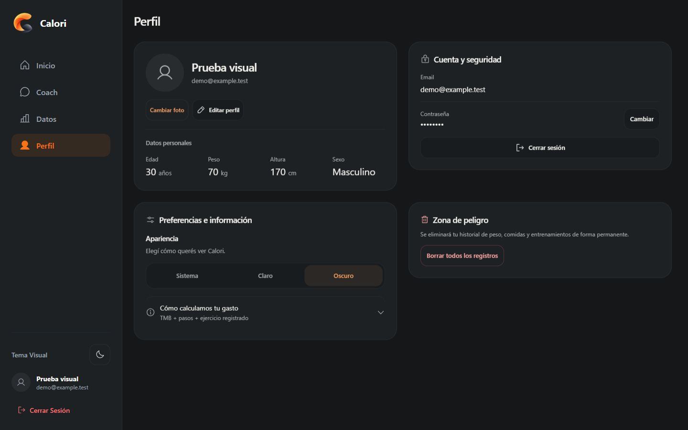
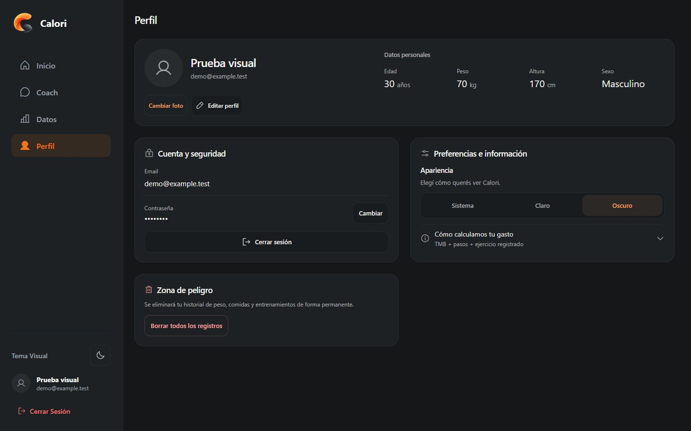
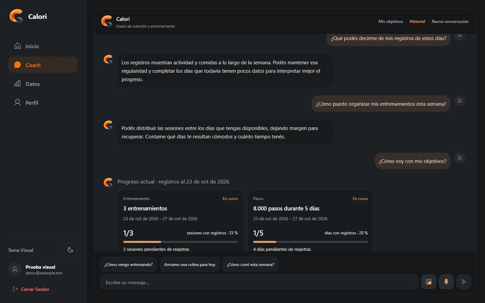
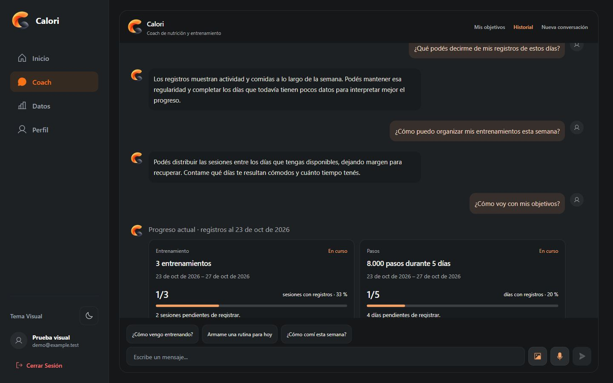
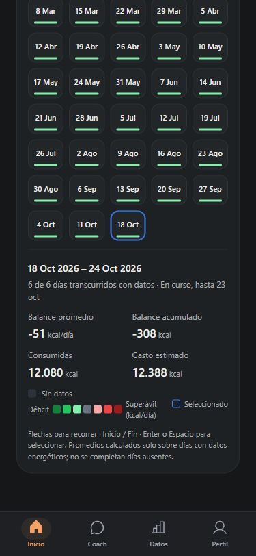
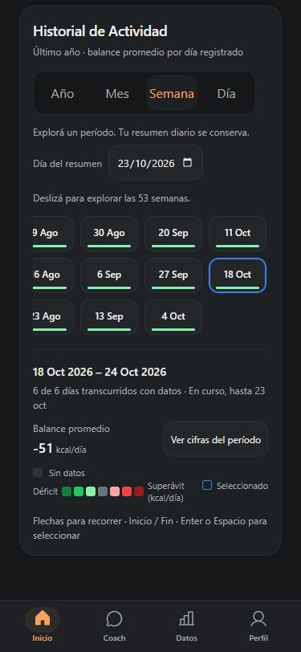

# Calori Premium V6 — revisión visual

Base: main b8259f8 (PR #64 integrado). Rama: codex/premium-ux-precision-v6. Fecha: 23 de octubre de 2026.

## Alcance y método

Se inspeccionaron las cuatro pantallas en navegador antes de editar. Las capturas corresponden a componentes reales de la app en un fixture local con datos sintéticos, servicios simulados y las mismas fórmulas existentes. No son pruebas autenticadas contra Supabase ni Gemini. El escenario comparable contiene siete comidas y un entrenamiento; no se alteraron sus datos entre las capturas iniciales y finales.

Se conservaron las fórmulas, registros, servicios, autenticación, cuotas, objetivos, endpoints y persistencia. No hay dependencias nuevas, migraciones ni despliegue manual a Production.

## Checkpoint A — estructura desktop

- Coach tenía un límite exterior propio de 1150 px, frente a los 1440 px del resto. Perfil también tenía uno de 1160 px. Ahora las cuatro pantallas usan el mismo token de ancho máximo, 1440 px. El gutter del contenedor principal se reserva también en Coach: desaparece la diferencia de 10 px observada al cambiar de pestaña.
- A 1920×1080 los cuatro marcos miden 1440 px. A 1440×900 miden 1126 px, comienzan en x=280 y terminan en x=1406. A 1366/1280/1024/768 sus anchos respectivos son 1052/966/710/454 px.
- Los mensajes de texto conservan un máximo de lectura de 640 px. Las tarjetas estructuradas pueden ocupar hasta 1080 px, incluido avatar y separación. No se modificaron ChatView ni los componentes de objetivos.
- Balance medía 156 px y cada hábito 152 px. La fila ahora usa stretch y altura natural: los cuatro paneles miden 164 px con datos habituales. Con cifras extremas en 1280 px crecen juntos a 183 px. Los botones de hábitos mantienen 44 px de alto y al menos 44 px de ancho.
- Datos usa un único gap de 24 px horizontal y vertical, padding de 20 px e interiores de 16 px. Solo Resumen y gráfico comparten el alto de su fila; Actividad y Comparación mantienen alto natural. La toolbar baja de 112 a 86,8 px sin quitar título, descripción, fechas ni selector. El contenido normal termina en y=846,5 a 1440×900. El período anual puede llegar a y=882,5 por texto legítimo adicional.
- Se comparó Perfil original con dos columnas contra identidad y datos personales arriba. Se eligió la segunda composición por separar identidad de ajustes y corregir la separación de 67 px que aparecía entre Cuenta y Zona de peligro. Las dos columnas inferiores miden 551 px con gap de 24 px. Cuenta y Preferencias miden 261 y 260,4 px; Zona de peligro comienza 24 px después de Cuenta. Al expandir contraseña e información conservan su altura natural y el mismo gap. La edición conserva el orden DOM y no deja una fila vacía para Zona de peligro.

## Checkpoint B — historial responsive

La geometría es específica por escala; no se modificaron intervalos, agregación energética, significado de colores, cobertura ni selección diaria.

- Semana móvil: 53 intervalos en tres filas horizontales con botones de 72×44 px, desplazamiento acotado a la grilla y una indicación visible para explorar. La selección se revela horizontalmente al entrar o cambiar el viewport; no se recentra tras una selección ni después de un desplazamiento manual. Las flechas siguen la geometría por columnas; Inicio/Fin y activación nativa se conservan.
- Mes móvil: tres columnas, etiquetas abreviadas y año visible. Fechas completas, cobertura, estado en curso y cifras siguen en el nombre accesible y en el detalle contextual. Los 12 meses permanecen disponibles.
- Año móvil: dos tarjetas lado a lado, ambos años accesibles y números capaces de saltar de línea. Los dos años originales se conservan.
- El detalle móvil mantiene período, cobertura y balance principal visibles. Un botón de 44 px permite abrir/cerrar las cifras completas y su explicación. En desktop todas las cifras permanecen visibles, independientemente del estado móvil.
- A 375 px la grilla semanal baja de 564 a 156 px; la mensual de 571,6 a 311,2 px; la anual de 272 a 130,6 px. La tarjeta completa pasa aproximadamente de 1134 a 701 px en Semana, de 1170 a 811 px en Mes y de 870 a 630 px en Año. Los textos variables pueden añadir una línea; se conserva scroll vertical natural del formulario/página.
- A 320 px los meses pueden envolver sus etiquetas y crecer: se prioriza lectura completa y controles accesibles sobre una altura fija. No aparece scroll horizontal de página.

## Checkpoint C — sistema y verificaciones

Tokens compartidos, acotados a app-shell: 4/8/12/16/20/24/32 px; 24 px estructural, 20 px de panel y 16 px interior. Radios: panel 20 px, widget 14 px y control 12 px. Encabezados desktop 17 px, títulos de pantalla 22 px y métricas secundarias 28 px. Balance mantiene su jerarquía propia. Se consolidaron las reglas existentes en lugar de agregar otra capa de compensaciones. No hay alturas fijas nuevas para tarjetas ni márgenes negativos.

Se revisaron Inicio, Datos, Perfil y Coach en 1920×1080, 1440×900, 1366×768, 1280×720, 1024×768, 768×1024, 430×932, 375×812 y 320×740. Las 36 combinaciones no tuvieron overflow horizontal de página. Debajo de desktop se conserva el apilado de Inicio; la igualdad de las cuatro tarjetas corresponde a la banda desktop.

También se revisaron:

- Inicio vacío, tres y ocho registros; cifras grandes y nombres largos; cuatro escalas.
- Datos Semana/Mes/Año, períodos vacíos y cifras grandes. Seleccionar barras no cambia el alto del gráfico ni la posición de las tarjetas inferiores: variación máxima registrada menor a 0,01 px por la animación existente, con tolerancia declarada de 0,1 px.
- Perfil normal, edición, validación HTML de edad inválida, cancelación y ajustes expandidos. La prueba visual no guarda contraseñas ni cambios remotos.
- Coach vacío, conversación larga, objetivos estructurados, historial y compositor multilínea. Al desplazar el transcript de scrollTop 1990,5 a 0, cabecera y compositor mantienen exactamente sus rectángulos; el contenedor principal no desplaza la página.
- Tema claro y oscuro. Controles con foco visible, selección, deshabilitados y estados vacíos. Se conservan las reglas de movimiento reducido y el orden de lectura.

## Validaciones

Suite completa final: node --test --test-concurrency=1 tests/*.test.mjs — 341/341 aprobados, 0 fallos y 0 omitidos (287,6 s). Incluye PostgreSQL nativo/RLS y la prueba HTTP del artefacto serverless compilado. Tests afectados: 98 aprobados en el checkpoint A; 14 del historial y 4 de contratos desktop/responsive aprobados. TypeScript: tsc -b y proyectos api/ai y api/coach aprobados. Lint: sin errores, 11 advertencias existentes. Build aprobado, con el aviso existente de chunk mayor a 500 kB. git diff --check aprobado.

La primera ejecución paralela agotó el límite de 90 s de la prueba nativa de PostgreSQL. Un probe local independiente inició PostgreSQL y respondió SELECT 1 correctamente; la repetición en serie pasó la prueba nativa en 36,6 s. No se cambió su timeout ni se debilitó la prueba. En la primera suite en serie una aserción antigua exigía que incluso los tokens compartidos estuvieran dentro de media queries: se actualizó para permitir exclusivamente custom properties en app-shell fuera del breakpoint, manteniendo la prohibición de reglas estructurales de desktop en móvil. Las pruebas de funcionalidad pasaron en ese intento (340/341); la repetición final se informa arriba.

Pruebas añadidas: navegación real por teclado en tres filas, disclosure que conserva métricas y borrador, revelado horizontal al redimensionar sin recenter posterior y contratos CSS de ancho/scroll/altura natural/mobile. JSDOM no calcula geometría: los tests de estilos comprueban contratos; las medidas de layout provienen del navegador, no de JSDOM.

Archivos de producto: DesktopExperience.css, index.css, HomeVariants.css, PremiumViews.css, Heatmap.tsx. ChartsView.tsx solo agrega una clase semántica al texto de la toolbar; ProfileView.tsx solo expone el estado de edición para el layout. Tests: history-experience, precision-layout y actualización del contrato en desktop-experience.

## Evidencia

Las mediciones DOM originales y finales están en [screenshots/premium-precision-v6](screenshots/premium-precision-v6). after-matrix.json registra las 36 combinaciones. before-desktop/before-wide/before-history contienen el estado inicial; history-matrix, chart-selection, coach-scroll, profile-expanded, empty-states y large-values contienen escenarios e interacciones.

### Desktop 1440×900

Inicio antes:

Inicio después:

Datos antes:

Datos después:

Perfil antes:

Perfil después:

Coach antes:

Coach después:

### Mobile 375×812

Inicio [antes](screenshots/premium-precision-v6/before-home-375.jpg) y [después](screenshots/premium-precision-v6/after-home-375.jpg).
Datos [antes](screenshots/premium-precision-v6/before-data-375.jpg) y [después](screenshots/premium-precision-v6/after-data-375.jpg).
Perfil [antes](screenshots/premium-precision-v6/before-profile-375.jpg) y [después](screenshots/premium-precision-v6/after-profile-375.jpg).
Coach [antes](screenshots/premium-precision-v6/before-coach-375.jpg) y [después](screenshots/premium-precision-v6/after-coach-375.jpg).

Semana antes:

Semana después:

Mes [antes](screenshots/premium-precision-v6/before-history-month-375.jpg) y [después](screenshots/premium-precision-v6/history-Mes-375.jpg).
Año [antes](screenshots/premium-precision-v6/before-history-year-375.jpg) y [después](screenshots/premium-precision-v6/history-Año-375.jpg).
[Detalle desplegado](screenshots/premium-precision-v6/checkpoint-b-detail-375.jpg).

### Estados adicionales

[Edición de Perfil](screenshots/premium-precision-v6/profile-edit-1440.jpg), [ajustes expandidos](screenshots/premium-precision-v6/profile-expanded-1440.jpg), [historial de Coach](screenshots/premium-precision-v6/coach-history-1440.jpg) y [cifras extremas](screenshots/premium-precision-v6/large-home-1280.jpg).

## Límites y revisión pendiente

La vista responsive es un navegador de escritorio con viewport emulado; no prueba teclado virtual, Safari/iOS ni hardware móvil. El navegador integrado no aplicó el atajo de zoom (innerWidth y DPR no cambiaron): zoom nativo 125/150 % y aumento de texto del sistema quedan pendientes de prueba manual, además de lector de pantalla y aprobación visual del usuario. No se simula CSS zoom como prueba de zoom real.

La comprobación del Preview público y su estado se informa en el PR. Sin una sesión de prueba autenticada en Preview no se afirma que estas capturas locales demuestren integración remota de IA, cuotas u objetivos. La aprobación visual final precede a cualquier integración a main.
